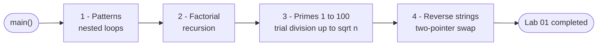
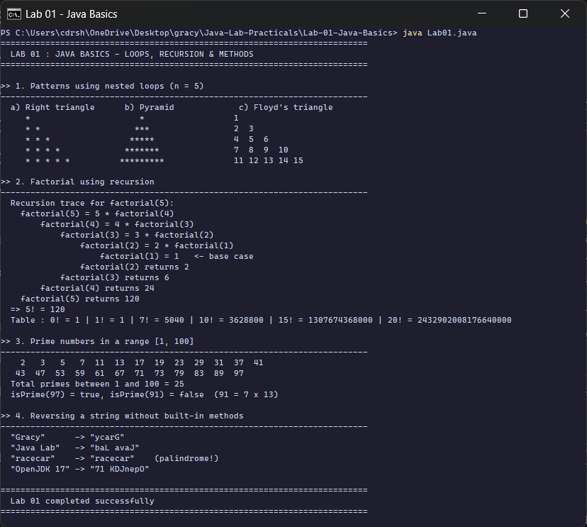

<div align="center">

# Lab 01 &nbsp;|&nbsp; Java Basics

**Nested loops &nbsp;·&nbsp; Recursion &nbsp;·&nbsp; Prime numbers &nbsp;·&nbsp; String reversal**


[All labs](../../README.md) &nbsp;&nbsp;|&nbsp;&nbsp; [Next: Lab 02 &rarr;](../Lab-02-BankAccount-Constructors/README.md)

</div>

---

## Aim

> Write Java programs to demonstrate **(1)** printing patterns using nested loops, **(2)** finding factorial using recursion, **(3)** checking prime numbers in a range, **(4)** reversing a string without using built-in methods.

| Course Outcome | Bloom's Level | Relevance | Hours | Evaluation |
|:--|:--:|:--:|:--:|:--|
| **CO1** - Understand Java environment and basic programming constructs | K2 - Understand | Global | 2 | Lab Tasks, Viva, Practical Record |

---

## Concepts at a glance

| # | Task | Java building blocks used | Method in [`Lab01.java`](Lab01.java) |
|:-:|:--|:--|:--|
| 1 | Patterns | nested `for` loops, string building, `printf` alignment | `rightTriangle()`, `pyramid()`, `floydsTriangle()` |
| 2 | Factorial | recursion, base case, call stack, `long` range | `factorial()`, `factorialTrace()` |
| 3 | Primes in a range | loops, `%` operator, early `return`, the &radic;n optimisation | `isPrime()` |
| 4 | Reverse a string | `char[]`, two-pointer swap, manual comparison | `reverse()`, `sameText()` |

Every task lives in its **own static method**, and `main()` only calls them and prints. That keeps each idea small, testable and reusable.

---

## Program flow



---

## Code walkthrough

### 1. Patterns with nested loops

The **outer loop picks the row**, the **inner loop prints the columns** of that row. The pyramid needs two inner loops: one for the leading spaces, one for the stars.

```java
for (int i = 1; i <= n; i++) {
    String row = "";
    for (int s = 1; s <= n - i; s++) row += " ";      // leading spaces
    for (int k = 1; k <= 2 * i - 1; k++) row += "*";  // stars
    rows[i - 1] = row;
}
```

| Pattern | Row `i` contains |
|:--|:--|
| Right triangle | `i` stars |
| Pyramid | `n - i` spaces, then `2i - 1` stars |
| Floyd's triangle | the next `i` natural numbers (a counter that keeps growing) |

The three patterns are built as `String[]` and printed **side by side** with `printf("%-18s %-22s %s")`.

### 2. Factorial using recursion

```java
static long factorial(int n) {
    if (n <= 1) return 1;                 // base case stops the recursion
    return n * factorial(n - 1);          // recursive case
}
```

`factorialTrace()` is the same logic but prints each call with indentation, so the output **shows the call stack going down** to the base case and **coming back up** with the results. `long` is used because `20!` (2,432,902,008,176,640,000) does not fit in an `int`.

### 3. Prime numbers in a range

```java
static boolean isPrime(int num) {
    if (num < 2) return false;
    for (int d = 2; d * d <= num; d++) {
        if (num % d == 0) return false;   // found a divisor -> not prime
    }
    return true;
}
```

A number only needs to be tested up to **&radic;num**: if `num = a x b` then one of `a` or `b` must be at most &radic;num. For 97 the loop stops after `d = 9` instead of `d = 96`.

### 4. Reversing a string without built-in methods

No `StringBuilder.reverse()` and no `Collections.reverse()`. Two indices start at both ends, swap characters and walk towards the middle.

```java
char[] chars = str.toCharArray();
int left = 0, right = chars.length - 1;
while (left < right) {
    char temp = chars[left];          // swap the two ends
    chars[left] = chars[right];
    chars[right] = temp;
    left++;
    right--;
}
```

This takes `n / 2` swaps, so it is **O(n)** time and works in place on the array. `sameText()` compares the original and reversed text character by character to flag palindromes (again without `equals()`).

---

## How to run

```bash
cd Java-Lab-Practicals/Lab-01-Java-Basics
java Lab01.java            # Java 11+ runs a single source file directly
```

<sub>Classic two-step way: `javac Lab01.java` then `java Lab01`.</sub>

---

## Output

<p align="center">
  
</p>

| Section | What the run shows | Why it is correct |
|:--|:--|:--|
| Patterns | 5-row triangle, pyramid and Floyd's triangle (1 to 15) | rows grow by 1, 2 and 1 items exactly as the loop bounds say |
| Factorial | trace `factorial(5)` &rarr; `factorial(1)` and back, `5! = 120`, `20! = 2432902008176640000` | each frame multiplies its `n` with the value returned from below |
| Primes | 25 primes between 1 and 100, `isPrime(91) = false` | 91 = 7 x 13, caught when `d = 7` (7 x 7 = 49 &le; 91) |
| Reverse | `"Gracy" -> "ycarG"`, `"racecar"` flagged as palindrome | reversed text equals the original only for `racecar` |

<details>
<summary><b>Output as plain text</b> (for the practical record)</summary>

```text
==========================================================================
  LAB 01 : JAVA BASICS - LOOPS, RECURSION & METHODS
==========================================================================

>> 1. Patterns using nested loops (n = 5)
--------------------------------------------------------------------------
  a) Right triangle      b) Pyramid             c) Floyd's triangle
     *                      *                  1
     * *                   ***                 2  3
     * * *                *****                4  5  6
     * * * *             *******               7  8  9  10
     * * * * *          *********              11 12 13 14 15

>> 2. Factorial using recursion
--------------------------------------------------------------------------
  Recursion trace for factorial(5):
    factorial(5) = 5 * factorial(4)
        factorial(4) = 4 * factorial(3)
            factorial(3) = 3 * factorial(2)
                factorial(2) = 2 * factorial(1)
                    factorial(1) = 1   <- base case
                factorial(2) returns 2
            factorial(3) returns 6
        factorial(4) returns 24
    factorial(5) returns 120
  => 5! = 120
  Table : 0! = 1 | 1! = 1 | 7! = 5040 | 10! = 3628800 | 15! = 1307674368000 | 20! = 2432902008176640000

>> 3. Prime numbers in a range [1, 100]
--------------------------------------------------------------------------
    2   3   5   7  11  13  17  19  23  29  31  37  41
   43  47  53  59  61  67  71  73  79  83  89  97
  Total primes between 1 and 100 = 25
  isPrime(97) = true, isPrime(91) = false  (91 = 7 x 13)

>> 4. Reversing a string without built-in methods
--------------------------------------------------------------------------
  "Gracy"      -> "ycarG"
  "Java Lab"   -> "baL avaJ"
  "racecar"    -> "racecar"    (palindrome!)
  "OpenJDK 17" -> "71 KDJnepO"

==========================================================================
  Lab 01 completed successfully
==========================================================================
```

</details>

---

## Viva questions

<details>
<summary><b>1. What is the difference between a loop and recursion?</b></summary>

A loop repeats a block using a counter and keeps one stack frame. Recursion solves a problem by calling the same method on a smaller input; every call gets its own stack frame. Recursion needs a **base case**, otherwise it ends in `StackOverflowError`.
</details>

<details>
<summary><b>2. Why does <code>factorial</code> return <code>long</code> and not <code>int</code>?</b></summary>

`int` holds values up to 2,147,483,647, so it overflows after `12!`. `long` holds up to about 9.22 x 10<sup>18</sup>, enough for `20!`. For bigger values use `java.math.BigInteger`.
</details>

<details>
<summary><b>3. Why do we check divisors only up to &radic;n?</b></summary>

If `n = a x b` and both `a` and `b` were greater than &radic;n, their product would be greater than `n`. So at least one factor is &le; &radic;n. Checking up to &radic;n is enough and makes the test much faster.
</details>

<details>
<summary><b>4. Is 1 a prime number?</b></summary>

No. A prime has exactly two distinct divisors, 1 and itself. 1 has only one divisor, which is why `isPrime()` returns `false` for `num < 2`.
</details>

<details>
<summary><b>5. What is the time complexity of the two-pointer reverse?</b></summary>

O(n) time with n/2 swaps, and O(n) extra space for the `char[]` copy (Strings are immutable, so a copy is unavoidable).
</details>

<details>
<summary><b>6. How does <code>java Lab01.java</code> run without <code>javac</code>?</b></summary>

Since Java 11 (JEP 330) the launcher can compile a single source file in memory and run its first top-level class. No `.class` file is written to disk.
</details>

---

## Result

The program was written, compiled and executed on **OpenJDK 17 (Temurin 17.0.19)**. All four tasks produced the expected output, as shown in the console output above.

<div align="center">

[All labs](../../README.md) &nbsp;&nbsp;|&nbsp;&nbsp; [Next: Lab 02 &rarr;](../Lab-02-BankAccount-Constructors/README.md)

</div>
