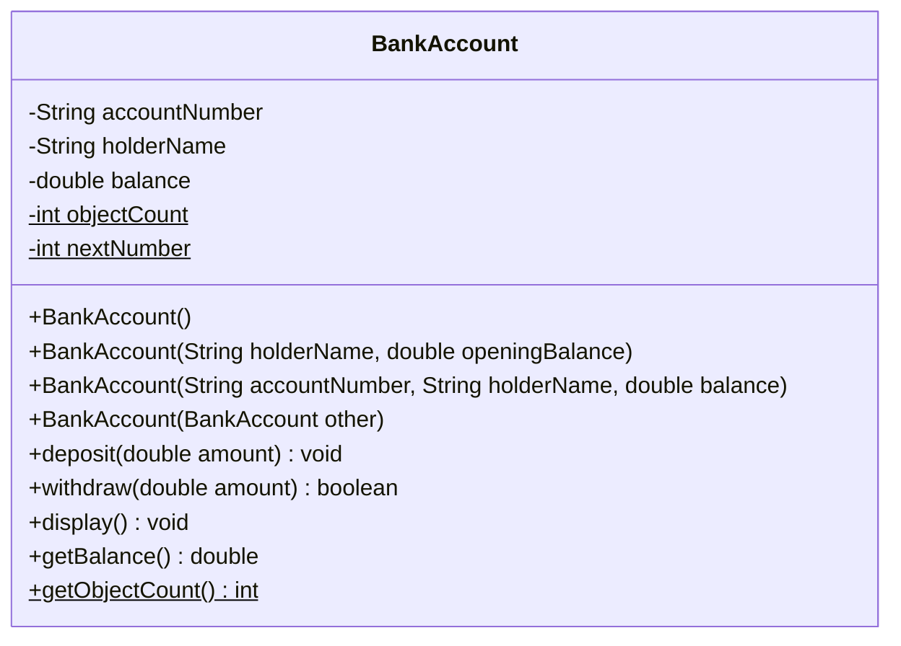
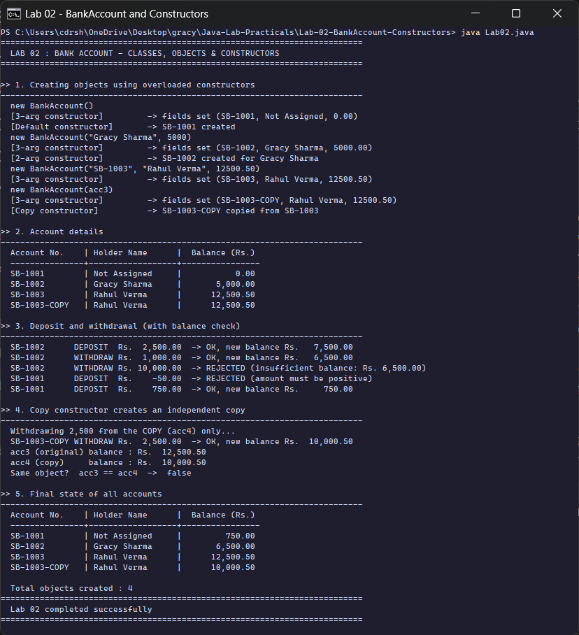

<div align="center">

# Lab 02 &nbsp;|&nbsp; BankAccount

**Classes &nbsp;·&nbsp; Objects &nbsp;·&nbsp; Default, Parameterized and Copy Constructors &nbsp;·&nbsp; Overloading**


[&larr; Lab 01](../Lab-01-Java-Basics/README.md) &nbsp;&nbsp;|&nbsp;&nbsp; [All labs](../../README.md) &nbsp;&nbsp;|&nbsp;&nbsp; [Lab 03 &rarr;](../Lab-03-Inheritance-Polymorphism/README.md)

</div>

---

## Aim

> Create a class `BankAccount` with attributes (account number, holder name, balance). Implement **default, parameterized and copy constructors**. Add methods for **deposit, withdrawal (with balance check) and display**. Create multiple objects and demonstrate **constructor overloading**.

| Course Outcome | Bloom's Level | Relevance | Hours | Evaluation |
|:--|:--:|:--:|:--:|:--|
| **CO1** - Implement OOP fundamentals using classes, objects and constructors | K3 - Apply | Global | 2 | Lab Tasks, Viva, Practical Record |

---

## Class design



<sub>`-` private, `+` public, `$` static. Fields are **private** (encapsulation); the only way to change the balance is through `deposit()` and `withdraw()`, which validate the amount.</sub>

---

## The four constructors (constructor overloading)

Same name, **different parameter lists**. The compiler picks the right one from the arguments.

| Constructor | Called as | What it does |
|:--|:--|:--|
| **Default** `BankAccount()` | `new BankAccount()` | auto account number, holder "Not Assigned", balance 0 |
| **Parameterized (2 args)** | `new BankAccount("Gracy Sharma", 5000)` | auto account number, given name and opening balance |
| **Parameterized (3 args)** | `new BankAccount("SB-1003", "Rahul Verma", 12500.50)` | the "main" constructor, sets every field |
| **Copy** `BankAccount(BankAccount other)` | `new BankAccount(acc3)` | builds a **new, independent** object with the same data |

All of them **chain to the 3-argument constructor** with `this(...)`, so the field-setting code is written only once:

```java
BankAccount() {
    this("SB-" + nextNumber++, "Not Assigned", 0.0);   // delegates to 3-arg constructor
    System.out.println("  [Default constructor]       -> " + accountNumber + " created");
}

BankAccount(BankAccount other) {                      // COPY constructor
    this(other.accountNumber + "-COPY", other.holderName, other.balance);
    System.out.println("  [Copy constructor]          -> " + accountNumber + " copied from " + other.accountNumber);
}
```

> `this(...)` must be the **first statement** of a constructor. That is why, in the output, the `[3-arg constructor]` line always prints **before** the message of the constructor that called it.

---

## Business rules in the methods

```java
boolean withdraw(double amount) {
    if (amount <= 0 || amount > balance) {           // balance check
        System.out.printf("... REJECTED (insufficient balance: Rs. %,.2f)%n", ...);
        return false;
    }
    balance -= amount;
    return true;
}
```

| Rule | Where | Seen in output |
|:--|:--|:--|
| Deposit must be positive | `deposit()` | `DEPOSIT Rs. -50.00 -> REJECTED` |
| Cannot withdraw more than the balance | `withdraw()` | `WITHDRAW Rs. 10,000.00 -> REJECTED` |
| Count every object ever created | `static int objectCount` | `Total objects created : 4` |

---

## How to run

```bash
cd Java-Lab-Practicals/Lab-02-BankAccount-Constructors
java Lab02.java
```

---

## Output

<p align="center">
  
</p>

| Section | What the run shows |
|:--|:--|
| 1. Overloaded constructors | four `new` calls; each prints the **chaining order** (3-arg body first, then the caller) |
| 2. Account details | the four objects in a formatted table |
| 3. Deposit / withdraw | two valid operations and two **rejected** ones (overdraw and negative amount) |
| 4. Copy constructor | withdrawing Rs. 2,500 from the copy leaves the original at Rs. 12,500.50, and `acc3 == acc4` is `false` |
| 5. Final state | updated balances and the static object counter (4) |

<details>
<summary><b>Output as plain text</b> (for the practical record)</summary>

```text
==========================================================================
  LAB 02 : BANK ACCOUNT - CLASSES, OBJECTS & CONSTRUCTORS
==========================================================================

>> 1. Creating objects using overloaded constructors
--------------------------------------------------------------------------
  new BankAccount()
  [3-arg constructor]         -> fields set (SB-1001, Not Assigned, 0.00)
  [Default constructor]       -> SB-1001 created
  new BankAccount("Gracy Sharma", 5000)
  [3-arg constructor]         -> fields set (SB-1002, Gracy Sharma, 5000.00)
  [2-arg constructor]         -> SB-1002 created for Gracy Sharma
  new BankAccount("SB-1003", "Rahul Verma", 12500.50)
  [3-arg constructor]         -> fields set (SB-1003, Rahul Verma, 12500.50)
  new BankAccount(acc3)
  [3-arg constructor]         -> fields set (SB-1003-COPY, Rahul Verma, 12500.50)
  [Copy constructor]          -> SB-1003-COPY copied from SB-1003

>> 2. Account details
--------------------------------------------------------------------------
  Account No.    | Holder Name      |  Balance (Rs.)
  ---------------+------------------+----------------
  SB-1001        | Not Assigned     |           0.00
  SB-1002        | Gracy Sharma     |       5,000.00
  SB-1003        | Rahul Verma      |      12,500.50
  SB-1003-COPY   | Rahul Verma      |      12,500.50

>> 3. Deposit and withdrawal (with balance check)
--------------------------------------------------------------------------
  SB-1002      DEPOSIT  Rs.  2,500.00  -> OK, new balance Rs.   7,500.00
  SB-1002      WITHDRAW Rs.  1,000.00  -> OK, new balance Rs.   6,500.00
  SB-1002      WITHDRAW Rs. 10,000.00  -> REJECTED (insufficient balance: Rs. 6,500.00)
  SB-1001      DEPOSIT  Rs.    -50.00  -> REJECTED (amount must be positive)
  SB-1001      DEPOSIT  Rs.    750.00  -> OK, new balance Rs.     750.00

>> 4. Copy constructor creates an independent copy
--------------------------------------------------------------------------
  Withdrawing 2,500 from the COPY (acc4) only...
  SB-1003-COPY WITHDRAW Rs.  2,500.00  -> OK, new balance Rs.  10,000.50
  acc3 (original) balance : Rs.  12,500.50
  acc4 (copy)     balance : Rs.  10,000.50
  Same object?  acc3 == acc4  ->  false

>> 5. Final state of all accounts
--------------------------------------------------------------------------
  Account No.    | Holder Name      |  Balance (Rs.)
  ---------------+------------------+----------------
  SB-1001        | Not Assigned     |         750.00
  SB-1002        | Gracy Sharma     |       6,500.00
  SB-1003        | Rahul Verma      |      12,500.50
  SB-1003-COPY   | Rahul Verma      |      10,000.50

  Total objects created : 4
==========================================================================
  Lab 02 completed successfully
==========================================================================
```

</details>

---

## Viva questions

<details>
<summary><b>1. What is a constructor? How is it different from a method?</b></summary>

A constructor initialises a new object. It has the **same name as the class**, has **no return type** (not even `void`) and runs automatically with `new`. A method has a return type and must be called explicitly.
</details>

<details>
<summary><b>2. When does Java give a default constructor automatically?</b></summary>

Only when the class declares **no constructor at all**. As soon as you write any constructor, the compiler stops adding the no-argument one, which is why `BankAccount()` is written explicitly here.
</details>

<details>
<summary><b>3. Why do we need a copy constructor if we can write <code>acc4 = acc3</code>?</b></summary>

`acc4 = acc3` copies the **reference**, so both names point to the same object and a withdrawal through one changes the other. The copy constructor creates a **separate object**, which the output proves: the copy's balance changed, the original's did not.
</details>

<details>
<summary><b>4. What is the difference between <code>this</code> and <code>this(...)</code>?</b></summary>

`this` refers to the current object (used here as `this.balance = balance` to separate the field from the parameter). `this(...)` calls another constructor of the same class and must be the first statement.
</details>

<details>
<summary><b>5. Why is <code>objectCount</code> static?</b></summary>

A static field belongs to the **class**, not to an object, so all objects share one counter. An instance field would give every object its own counter that always says 1.
</details>

---

## Result

The `BankAccount` class with default, parameterized and copy constructors was implemented and executed on **OpenJDK 17**. Constructor overloading, chaining, balance validation and object independence were verified, as shown in the console output above.

<div align="center">

[&larr; Lab 01](../Lab-01-Java-Basics/README.md) &nbsp;&nbsp;|&nbsp;&nbsp; [All labs](../../README.md) &nbsp;&nbsp;|&nbsp;&nbsp; [Lab 03 &rarr;](../Lab-03-Inheritance-Polymorphism/README.md)

</div>
