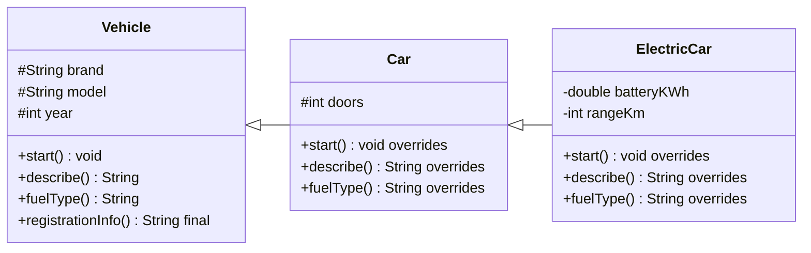
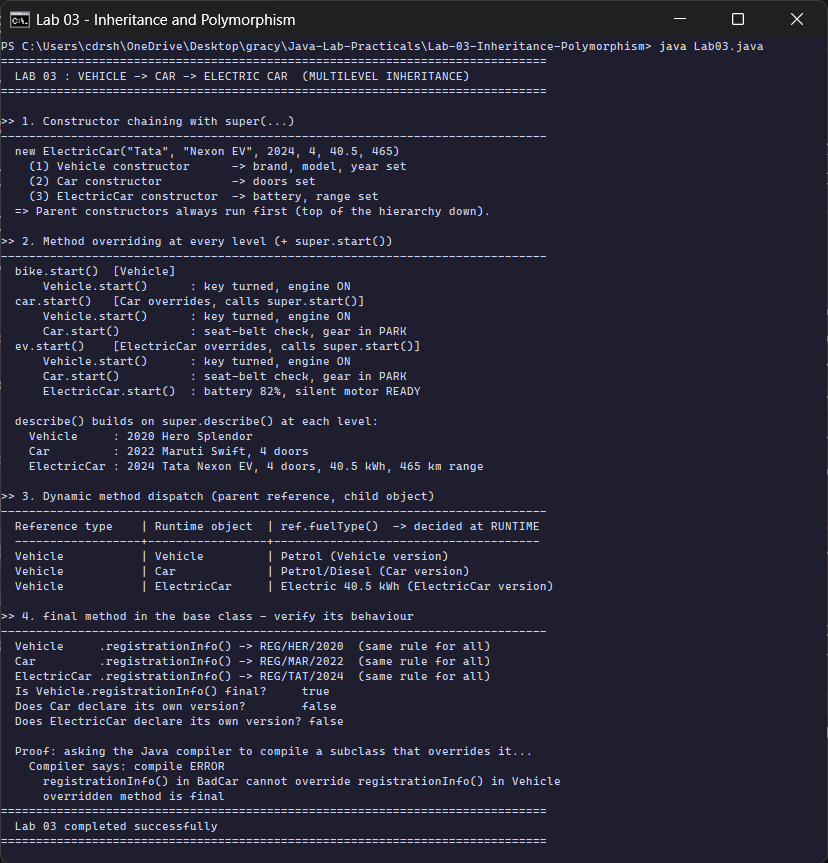

<div align="center">

# Lab 03 &nbsp;|&nbsp; Vehicle &rarr; Car &rarr; ElectricCar

**Multilevel inheritance &nbsp;·&nbsp; Method overriding &nbsp;·&nbsp; `super` &nbsp;·&nbsp; Dynamic method dispatch &nbsp;·&nbsp; `final`**


[&larr; Lab 02](../Lab-02-BankAccount-Constructors/README.md) &nbsp;&nbsp;|&nbsp;&nbsp; [All labs](../../README.md) &nbsp;&nbsp;|&nbsp;&nbsp; [Lab 04 &rarr;](../Lab-04-Interfaces-Abstract-Classes/README.md)

</div>

---

## Aim

> Design a class hierarchy **Vehicle &rarr; Car &rarr; ElectricCar**. Implement multilevel inheritance with attributes and methods. Demonstrate **method overriding at each level**, use of the **`super` keyword**, and **dynamic method dispatch**. Add a **`final` method** in the base class and verify its behaviour.

| Course Outcome | Bloom's Level | Relevance | Hours | Evaluation |
|:--|:--:|:--:|:--:|:--|
| **CO2** - Apply inheritance and polymorphism in Java programs | K3 - Apply | Global | 2 | Lab Tasks, Viva, Practical Record |

---

## Class hierarchy



<sub>Fields are `protected` (`#`) so subclasses can use them. `registrationInfo()` is `final`, so neither `Car` nor `ElectricCar` can override it.</sub>

---

## The four ideas, mapped to the code

| Concept | How it is shown | Proof in the output |
|:--|:--|:--|
| **Constructor chaining** | each constructor calls `super(...)` first | `(1) Vehicle` &rarr; `(2) Car` &rarr; `(3) ElectricCar` |
| **Overriding at every level** | `start()`, `describe()`, `fuelType()` redefined in each class | three different `start()` outputs |
| **`super` keyword** | `super(...)` for constructors, `super.start()` and `super.describe()` for methods | `ev.start()` prints all three levels |
| **Dynamic method dispatch** | `Vehicle ref` holding a `Car` or `ElectricCar` | the table: same reference type, different `fuelType()` |
| **`final` method** | `final String registrationInfo()` in `Vehicle` | reflection says `final = true`, and the compiler rejects an override |

---

## Code walkthrough

### `super` reuses the parent's behaviour

```java
class ElectricCar extends Car {
    @Override
    void start() {
        super.start();                             // runs Car.start(), which runs Vehicle.start()
        System.out.println("      ElectricCar.start()  : battery 82%, silent motor READY");
    }
}
```

Each level **adds** to what its parent does instead of copying it, so `ev.start()` prints the Vehicle line, then the Car line, then its own line.

### Dynamic method dispatch (runtime polymorphism)

```java
Vehicle[] garage = { bike, car, ev };          // all stored as Vehicle references
for (Vehicle ref : garage) {
    ref.fuelType();                            // which version? decided at RUNTIME
}
```

The **reference type** (`Vehicle`) decides *which methods may be called*. The **object type** (`Vehicle`, `Car`, `ElectricCar`) decides *which version runs*. The JVM looks it up at runtime through the object's method table.

### `final` method, verified two ways

```java
final String registrationInfo() {
    return "REG/" + brand.substring(0, 3).toUpperCase() + "/" + year + "  (same rule for all)";
}
```

1. **Reflection:** `Modifier.isFinal(...)` returns `true`, and `getDeclaredMethod` on `Car` / `ElectricCar` finds no own version.
2. **The compiler itself:** the program compiles a tiny `BadCar` class **in memory** with `javax.tools.JavaCompiler`. `BadCar` tries to override the final method, and the real compiler error is printed:
   `registrationInfo() in BadCar cannot override registrationInfo() in Vehicle - overridden method is final`

---

## How to run

```bash
cd Java-Lab-Practicals/Lab-03-Inheritance-Polymorphism
java Lab03.java
```

---

## Output

<p align="center">
  
</p>

| Section | What the run shows |
|:--|:--|
| 1. Constructor chaining | one `new ElectricCar(...)` runs **three** constructors, parent first |
| 2. Overriding + `super` | `bike.start()` prints 1 line, `car.start()` 2 lines, `ev.start()` 3 lines |
| 3. Dynamic dispatch | three `Vehicle` references give three different `fuelType()` results |
| 4. `final` method | same registration rule for all three objects; `final = true`; compile error for the override attempt |

<details>
<summary><b>Output as plain text</b> (for the practical record)</summary>

```text
==============================================================================
  LAB 03 : VEHICLE -> CAR -> ELECTRIC CAR  (MULTILEVEL INHERITANCE)
==============================================================================

>> 1. Constructor chaining with super(...)
------------------------------------------------------------------------------
  new ElectricCar("Tata", "Nexon EV", 2024, 4, 40.5, 465)
    (1) Vehicle constructor      -> brand, model, year set
    (2) Car constructor          -> doors set
    (3) ElectricCar constructor  -> battery, range set
  => Parent constructors always run first (top of the hierarchy down).

>> 2. Method overriding at every level (+ super.start())
------------------------------------------------------------------------------
  bike.start()  [Vehicle]
      Vehicle.start()      : key turned, engine ON
  car.start()   [Car overrides, calls super.start()]
      Vehicle.start()      : key turned, engine ON
      Car.start()          : seat-belt check, gear in PARK
  ev.start()    [ElectricCar overrides, calls super.start()]
      Vehicle.start()      : key turned, engine ON
      Car.start()          : seat-belt check, gear in PARK
      ElectricCar.start()  : battery 82%, silent motor READY

  describe() builds on super.describe() at each level:
    Vehicle     : 2020 Hero Splendor
    Car         : 2022 Maruti Swift, 4 doors
    ElectricCar : 2024 Tata Nexon EV, 4 doors, 40.5 kWh, 465 km range

>> 3. Dynamic method dispatch (parent reference, child object)
------------------------------------------------------------------------------
  Reference type    | Runtime object  | ref.fuelType()  -> decided at RUNTIME
  ------------------+-----------------+--------------------------------------
  Vehicle           | Vehicle         | Petrol (Vehicle version)
  Vehicle           | Car             | Petrol/Diesel (Car version)
  Vehicle           | ElectricCar     | Electric 40.5 kWh (ElectricCar version)

>> 4. final method in the base class - verify its behaviour
------------------------------------------------------------------------------
  Vehicle     .registrationInfo() -> REG/HER/2020  (same rule for all)
  Car         .registrationInfo() -> REG/MAR/2022  (same rule for all)
  ElectricCar .registrationInfo() -> REG/TAT/2024  (same rule for all)
  Is Vehicle.registrationInfo() final?     true
  Does Car declare its own version?        false
  Does ElectricCar declare its own version? false

  Proof: asking the Java compiler to compile a subclass that overrides it...
    Compiler says: compile ERROR
      registrationInfo() in BadCar cannot override registrationInfo() in Vehicle
      overridden method is final
==============================================================================
  Lab 03 completed successfully
==============================================================================
```

</details>

---

## Viva questions

<details>
<summary><b>1. What is multilevel inheritance? Does Java support multiple inheritance of classes?</b></summary>

Multilevel inheritance is a chain: `ElectricCar` extends `Car`, which extends `Vehicle`. Java does **not** allow a class to extend two classes (that would cause the diamond problem), but a class can implement many interfaces (see Lab 04).
</details>

<details>
<summary><b>2. Overloading vs overriding?</b></summary>

**Overloading**: same name, different parameters, in the same class; resolved at **compile time**. **Overriding**: same signature in a subclass; resolved at **runtime** through dynamic dispatch.
</details>

<details>
<summary><b>3. Can a final method be inherited? Can it be overloaded?</b></summary>

Yes, it is inherited (every vehicle calls `registrationInfo()`), and it can be overloaded with different parameters. It just cannot be **overridden**.
</details>

<details>
<summary><b>4. Why must <code>super(...)</code> be the first statement in a constructor?</b></summary>

The parent part of the object must be fully built before the child uses it. If you do not write `super(...)`, the compiler inserts `super()` automatically, and fails if the parent has no no-argument constructor.
</details>

<details>
<summary><b>5. What does the <code>@Override</code> annotation do?</b></summary>

It asks the compiler to check that the method really overrides a parent method. A typo such as `strat()` becomes a compile error instead of a silent new method.
</details>

---

## Result

The Vehicle &rarr; Car &rarr; ElectricCar hierarchy was implemented and executed on **OpenJDK 17**. Constructor chaining, overriding with `super`, dynamic method dispatch and the protection given by a `final` method were all verified, as shown in the console output above.

<div align="center">

[&larr; Lab 02](../Lab-02-BankAccount-Constructors/README.md) &nbsp;&nbsp;|&nbsp;&nbsp; [All labs](../../README.md) &nbsp;&nbsp;|&nbsp;&nbsp; [Lab 04 &rarr;](../Lab-04-Interfaces-Abstract-Classes/README.md)

</div>
