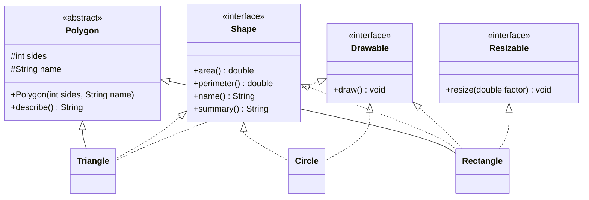
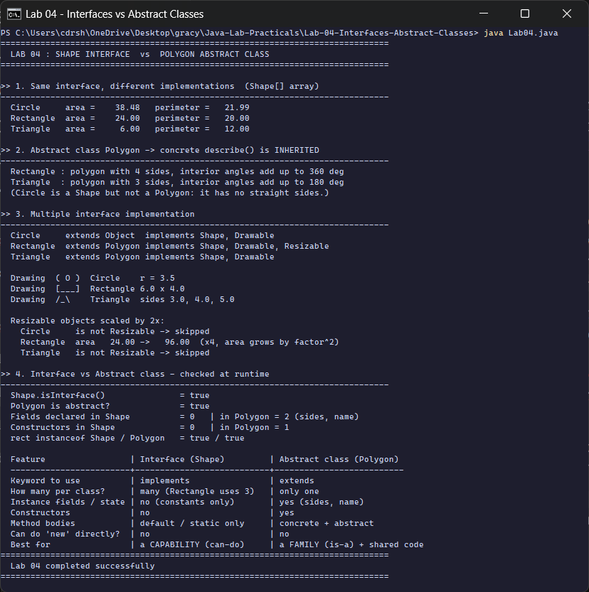

<div align="center">

# Lab 04 &nbsp;|&nbsp; Shape Interface vs Polygon Abstract Class

**Interfaces &nbsp;·&nbsp; Abstract classes &nbsp;·&nbsp; Multiple interface implementation &nbsp;·&nbsp; Driver class**


[&larr; Lab 03](../Lab-03-Inheritance-Polymorphism/README.md) &nbsp;&nbsp;|&nbsp;&nbsp; [All labs](../../README.md) &nbsp;&nbsp;|&nbsp;&nbsp; [Lab 05 &rarr;](../Lab-05-Exception-Handling/README.md)

</div>

---

## Aim

> Create an interface `Shape` with abstract methods `area()` and `perimeter()`. Implement it in classes `Circle`, `Rectangle` and `Triangle`. Create an abstract class `Polygon` with a concrete method `describe()`. Demonstrate **multiple interface implementation** and **compare behaviour with abstract classes** through a **driver class**.

| Course Outcome | Bloom's Level | Relevance | Hours | Evaluation |
|:--|:--:|:--:|:--:|:--|
| **CO2** - Apply interfaces and abstract classes for modular design | K3 - Apply | Global | 2 | Lab Tasks, Viva, Practical Record |

---

## Design



<sub>Dotted arrows = `implements` (an interface), solid arrows = `extends` (a class). `Rectangle` **extends one** abstract class and **implements three** interfaces at the same time. `Circle` is a `Shape` but not a `Polygon`, because it has no straight sides.</sub>

`Lab04` is the **driver class**: it creates the objects and exercises every feature through `Shape`, `Polygon`, `Drawable` and `Resizable` references.

---

## Code walkthrough

### The interface: a contract

```java
interface Shape {
    double area();                       // abstract (implicitly public abstract)
    double perimeter();                  // abstract
    String name();

    default String summary() {           // default method - interfaces may carry a body since Java 8
        return String.format("%-10s area = %8.2f   perimeter = %7.2f", name(), area(), perimeter());
    }
}
```

### The abstract class: shared state and shared code

```java
abstract class Polygon {
    protected final int sides;           // abstract classes CAN hold state
    protected final String name;

    Polygon(int sides, String name) {    // ...and CAN have constructors
        this.sides = sides;
        this.name = name;
    }

    String describe() {                  // concrete method - every Polygon gets this for free
        int angleSum = (sides - 2) * 180;
        return String.format("%-9s : polygon with %d sides, interior angles add up to %d deg", name, sides, angleSum);
    }
}
```

### Multiple interface implementation

```java
class Rectangle extends Polygon implements Shape, Drawable, Resizable { ... }
```

The driver uses **pattern matching for `instanceof`** (Java 16+) to call a capability only when the object has it:

```java
for (Shape s : shapes) {
    if (s instanceof Resizable r) {      // only Rectangle passes this test
        r.resize(2);
    }
}
```

### The maths

| Shape | Area | Perimeter |
|:--|:--|:--|
| Circle (r = 3.5) | &pi;r&sup2; = 38.48 | 2&pi;r = 21.99 |
| Rectangle (6 x 4) | l x b = 24.00 | 2(l + b) = 20.00 |
| Triangle (3, 4, 5) | Heron: &radic;(s(s-a)(s-b)(s-c)), s = 6 &rarr; 6.00 | a + b + c = 12.00 |

The `Triangle` constructor also rejects impossible sides (triangle inequality) with an `IllegalArgumentException`.

---

## Interface vs abstract class

The driver prints this comparison, and backs it up with **runtime checks** through reflection (`isInterface()`, `Modifier.isAbstract()`, field and constructor counts).

| Feature | Interface (`Shape`) | Abstract class (`Polygon`) |
|:--|:--|:--|
| Keyword | `implements` | `extends` |
| How many per class | many (Rectangle uses 3) | only one |
| Instance fields / state | no, constants only | yes (`sides`, `name`) |
| Constructors | no | yes |
| Method bodies | `default` / `static` only | concrete and abstract |
| `new` directly | not allowed | not allowed |
| Best for | a **capability** (can-do) | a **family** (is-a) with shared code |

---

## How to run

```bash
cd Java-Lab-Practicals/Lab-04-Interfaces-Abstract-Classes
java Lab04.java
```

---

## Output

<p align="center">
  
</p>

| Section | What the run shows |
|:--|:--|
| 1. `Shape[]` polymorphism | one loop, three implementations of `area()` and `perimeter()` |
| 2. `describe()` | inherited from `Polygon` by Rectangle (360 deg) and Triangle (180 deg) |
| 3. Multiple interfaces | each class's parent and interface list read at runtime; `draw()` for all; only Rectangle resizes (area x4 for a 2x scale) |
| 4. Comparison | reflection confirms: Shape has 0 fields and 0 constructors, Polygon has 2 fields and 1 constructor |

<details>
<summary><b>Output as plain text</b> (for the practical record)</summary>

```text
==============================================================================
  LAB 04 : SHAPE INTERFACE  vs  POLYGON ABSTRACT CLASS
==============================================================================

>> 1. Same interface, different implementations  (Shape[] array)
------------------------------------------------------------------------------
  Circle     area =    38.48   perimeter =   21.99
  Rectangle  area =    24.00   perimeter =   20.00
  Triangle   area =     6.00   perimeter =   12.00

>> 2. Abstract class Polygon -> concrete describe() is INHERITED
------------------------------------------------------------------------------
  Rectangle : polygon with 4 sides, interior angles add up to 360 deg
  Triangle  : polygon with 3 sides, interior angles add up to 180 deg
  (Circle is a Shape but not a Polygon: it has no straight sides.)

>> 3. Multiple interface implementation
------------------------------------------------------------------------------
  Circle     extends Object  implements Shape, Drawable
  Rectangle  extends Polygon implements Shape, Drawable, Resizable
  Triangle   extends Polygon implements Shape, Drawable

  Drawing  ( O )  Circle    r = 3.5
  Drawing  [___]  Rectangle 6.0 x 4.0
  Drawing  /_\    Triangle  sides 3.0, 4.0, 5.0

  Resizable objects scaled by 2x:
    Circle     is not Resizable -> skipped
    Rectangle  area   24.00 ->   96.00  (x4, area grows by factor^2)
    Triangle   is not Resizable -> skipped

>> 4. Interface vs Abstract class - checked at runtime
------------------------------------------------------------------------------
  Shape.isInterface()               = true
  Polygon is abstract?              = true
  Fields declared in Shape          = 0   | in Polygon = 2 (sides, name)
  Constructors in Shape             = 0   | in Polygon = 1
  rect instanceof Shape / Polygon   = true / true

  Feature                 | Interface (Shape)         | Abstract class (Polygon)
  ------------------------+---------------------------+--------------------------
  Keyword to use          | implements                | extends
  How many per class?     | many (Rectangle uses 3)   | only one
  Instance fields / state | no (constants only)       | yes (sides, name)
  Constructors            | no                        | yes
  Method bodies           | default / static only     | concrete + abstract
  Can do 'new' directly?  | no                        | no
  Best for                | a CAPABILITY (can-do)     | a FAMILY (is-a) + shared code
==============================================================================
  Lab 04 completed successfully
==============================================================================
```

</details>

---

## Viva questions

<details>
<summary><b>1. When would you choose an abstract class over an interface?</b></summary>

When related classes share **state or code** (like `sides` and `describe()` for every polygon). Choose an interface when unrelated classes share a **capability** (anything can be `Drawable`).
</details>

<details>
<summary><b>2. Can an interface have method bodies?</b></summary>

Yes, since Java 8: `default` and `static` methods. Since Java 9 it can also have `private` methods. It still cannot have instance fields or constructors.
</details>

<details>
<summary><b>3. Why does doubling the rectangle's sides make its area 4 times bigger?</b></summary>

Area is length x breadth; both are doubled, so area grows by 2 x 2 = 4. Area always scales with the **square** of the scale factor.
</details>

<details>
<summary><b>4. Can we create an object of an abstract class?</b></summary>

No, `new Polygon(...)` is a compile error. But its constructor still runs when a subclass is created (`super(4, "Rectangle")`).
</details>

<details>
<summary><b>5. What if two interfaces have the same default method?</b></summary>

The implementing class must override it to resolve the conflict, and can call a specific one with `InterfaceName.super.method()`.
</details>

---

## Result

The `Shape` interface, the `Polygon` abstract class and the `Circle`, `Rectangle` and `Triangle` implementations were executed through the `Lab04` driver class on **OpenJDK 17**. Multiple interface implementation and the differences from abstract classes were demonstrated and verified at runtime.

<div align="center">

[&larr; Lab 03](../Lab-03-Inheritance-Polymorphism/README.md) &nbsp;&nbsp;|&nbsp;&nbsp; [All labs](../../README.md) &nbsp;&nbsp;|&nbsp;&nbsp; [Lab 05 &rarr;](../Lab-05-Exception-Handling/README.md)

</div>
