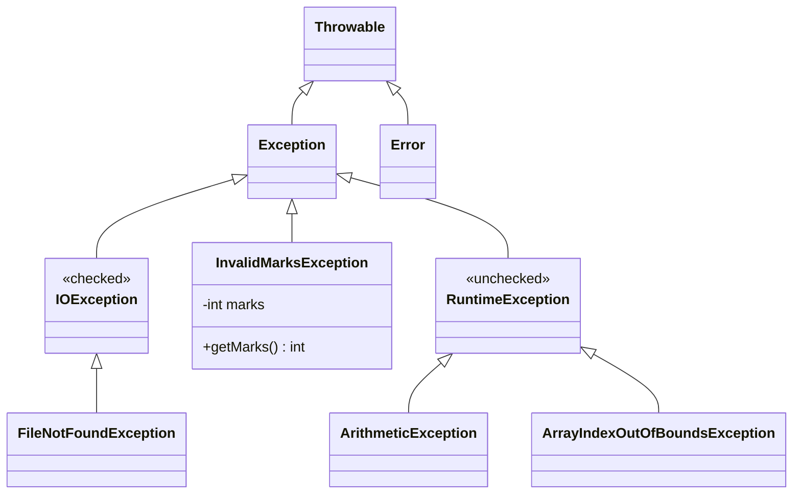
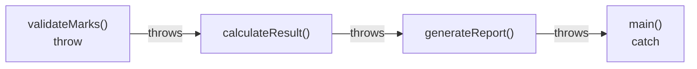
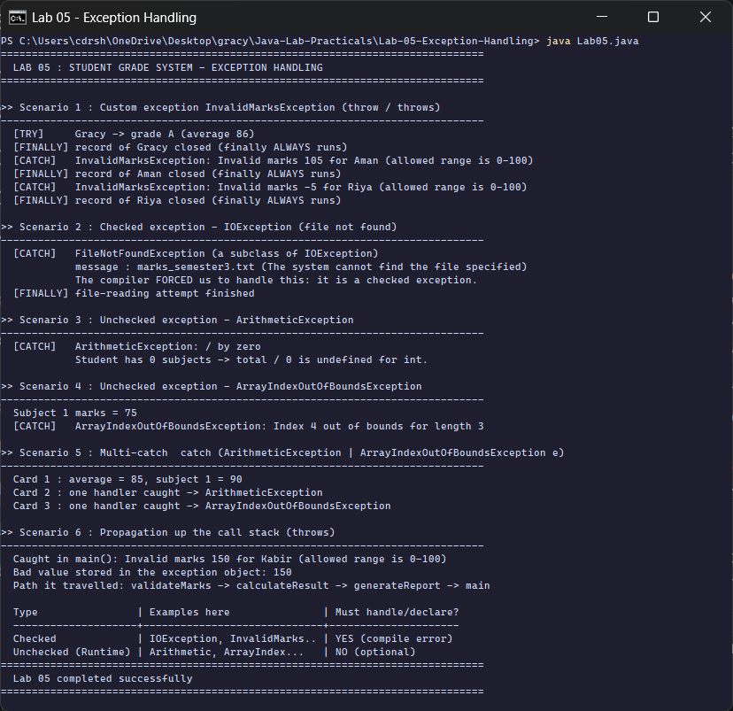

<div align="center">

# Lab 05 &nbsp;|&nbsp; Student Grade System

**Custom exceptions &nbsp;·&nbsp; try-catch-finally &nbsp;·&nbsp; Multi-catch &nbsp;·&nbsp; `throw` and `throws` &nbsp;·&nbsp; Checked vs unchecked**


[&larr; Lab 04](../Lab-04-Interfaces-Abstract-Classes/README.md) &nbsp;&nbsp;|&nbsp;&nbsp; [All labs](../../README.md) &nbsp;&nbsp;|&nbsp;&nbsp; [Lab 06 &rarr;](../Lab-06-Strings-File-IO/README.md)

</div>

---

## Aim

> Write a program simulating a student grade system. Create a custom exception `InvalidMarksException` thrown when marks are out of range (0-100). Demonstrate **try-catch-finally, multi-catch blocks, `throw` and `throws`**. Handle both **checked** (`IOException`) and **unchecked** (`ArithmeticException`, `ArrayIndexOutOfBoundsException`) exceptions in separate scenarios.

| Course Outcome | Bloom's Level | Relevance | Hours | Evaluation |
|:--|:--:|:--:|:--:|:--|
| **CO3** - Implement robust exception handling in Java applications | K3 - Apply | Global | 2 | Lab Tasks, Viva, Practical Record |

---

## Where these exceptions sit in Java's hierarchy



<sub>Anything under `RuntimeException` is **unchecked**: the compiler does not force you to handle it. Everything else under `Exception` (including our `InvalidMarksException`) is **checked**: you must catch it or declare it with `throws`.</sub>

---

## Six scenarios

| # | Scenario | Exception | Kind | Keywords shown |
|:-:|:--|:--|:--|:--|
| 1 | Marks 105 and -5 entered | `InvalidMarksException` (custom) | checked | `throw`, `throws`, `try`, `catch`, `finally` |
| 2 | Reading a marks file that does not exist | `FileNotFoundException` (an `IOException`) | checked | `throws IOException`, try-with-resources |
| 3 | Average of a student with 0 subjects | `ArithmeticException` | unchecked | `catch` |
| 4 | Reading subject 5 of a 3-subject array | `ArrayIndexOutOfBoundsException` | unchecked | `catch` |
| 5 | Three report cards, two different failures | both of the above | unchecked | multi-catch `A \| B` |
| 6 | Error raised 3 calls deep | `InvalidMarksException` | checked | propagation via `throws` |

---

## Code walkthrough

### The custom exception

```java
class InvalidMarksException extends Exception {     // extends Exception -> CHECKED
    private final int marks;

    InvalidMarksException(String studentName, int marks) {
        super("Invalid marks " + marks + " for " + studentName + " (allowed range is 0-100)");
        this.marks = marks;                          // extra data travels with the exception
    }

    int getMarks() { return marks; }
}
```

### `throws` declares, `throw` raises

```java
static void validateMarks(String name, int marks) throws InvalidMarksException {
    if (marks < 0 || marks > 100) {
        throw new InvalidMarksException(name, marks);     // 'throw' actually raises it
    }
}
```

### try - catch - finally

```java
try {
    String grade = GradeSystem.processStudent(names[i], attempts[i]);   // may throw
    System.out.println("  [TRY]     " + names[i] + " -> grade " + grade);
} catch (InvalidMarksException e) {
    System.out.println("  [CATCH]   " + e.getClass().getSimpleName() + ": " + e.getMessage());
} finally {
    System.out.println("  [FINALLY] record of " + names[i] + " closed (finally ALWAYS runs)");
}
```

### Multi-catch (Java 7+)

```java
} catch (ArithmeticException | ArrayIndexOutOfBoundsException e) {
    System.out.println("  Card " + (i + 1) + " : one handler caught -> " + e.getClass().getSimpleName());
}
```

One handler for two unrelated exception types, no duplicated code.

### Propagation through the call stack



Nobody in the middle catches the exception; each method only declares `throws`. `main()` catches it and prints the path from the stack trace.

---

## How to run

```bash
cd Java-Lab-Practicals/Lab-05-Exception-Handling
java Lab05.java
```

---

## Output

<p align="center">
  
</p>

| Scenario | What the run shows |
|:--|:--|
| 1 | Gracy gets grade A (average 86); Aman (105) and Riya (-5) are rejected; `finally` prints for **all three** |
| 2 | `FileNotFoundException` for `marks_semester3.txt`, caught as `IOException` |
| 3 | `/ by zero` caught for a student with no subjects |
| 4 | subject 1 prints, subject 5 throws `Index 4 out of bounds for length 3` |
| 5 | card 1 succeeds, card 2 and card 3 fail differently but share **one** handler |
| 6 | path `validateMarks -> calculateResult -> generateReport -> main`, bad value 150 read from the exception object |

<details>
<summary><b>Output as plain text</b> (for the practical record)</summary>

```text
==============================================================================
  LAB 05 : STUDENT GRADE SYSTEM - EXCEPTION HANDLING
==============================================================================

>> Scenario 1 : Custom exception InvalidMarksException (throw / throws)
------------------------------------------------------------------------------
  [TRY]     Gracy -> grade A (average 86)
  [FINALLY] record of Gracy closed (finally ALWAYS runs)
  [CATCH]   InvalidMarksException: Invalid marks 105 for Aman (allowed range is 0-100)
  [FINALLY] record of Aman closed (finally ALWAYS runs)
  [CATCH]   InvalidMarksException: Invalid marks -5 for Riya (allowed range is 0-100)
  [FINALLY] record of Riya closed (finally ALWAYS runs)

>> Scenario 2 : Checked exception - IOException (file not found)
------------------------------------------------------------------------------
  [CATCH]   FileNotFoundException (a subclass of IOException)
            message : marks_semester3.txt (The system cannot find the file specified)
            The compiler FORCED us to handle this: it is a checked exception.
  [FINALLY] file-reading attempt finished

>> Scenario 3 : Unchecked exception - ArithmeticException
------------------------------------------------------------------------------
  [CATCH]   ArithmeticException: / by zero
            Student has 0 subjects -> total / 0 is undefined for int.

>> Scenario 4 : Unchecked exception - ArrayIndexOutOfBoundsException
------------------------------------------------------------------------------
  Subject 1 marks = 75
  [CATCH]   ArrayIndexOutOfBoundsException: Index 4 out of bounds for length 3

>> Scenario 5 : Multi-catch  catch (ArithmeticException | ArrayIndexOutOfBoundsException e)
------------------------------------------------------------------------------
  Card 1 : average = 85, subject 1 = 90
  Card 2 : one handler caught -> ArithmeticException
  Card 3 : one handler caught -> ArrayIndexOutOfBoundsException

>> Scenario 6 : Propagation up the call stack (throws)
------------------------------------------------------------------------------
  Caught in main(): Invalid marks 150 for Kabir (allowed range is 0-100)
  Bad value stored in the exception object: 150
  Path it travelled: validateMarks -> calculateResult -> generateReport -> main

  Type                | Examples here               | Must handle/declare?
  --------------------+-----------------------------+---------------------
  Checked             | IOException, InvalidMarks.. | YES (compile error)
  Unchecked (Runtime) | Arithmetic, ArrayIndex...   | NO (optional)
==============================================================================
  Lab 05 completed successfully
==============================================================================
```

</details>

---

## Viva questions

<details>
<summary><b>1. Checked vs unchecked exceptions?</b></summary>

**Checked** exceptions (subclasses of `Exception` but not `RuntimeException`) are verified at compile time: you must catch or declare them. **Unchecked** exceptions (`RuntimeException` and its subclasses) usually mean a programming bug and do not have to be declared.
</details>

<details>
<summary><b>2. Difference between <code>throw</code> and <code>throws</code>?</b></summary>

`throw` is a statement that **raises** one exception object. `throws` is part of a method signature that **declares** which checked exceptions the method may pass to its caller.
</details>

<details>
<summary><b>3. Does <code>finally</code> always run?</b></summary>

Yes, whether the `try` succeeds, an exception is caught, or even when the `try` has a `return`. It is skipped only if the JVM stops (for example `System.exit()`) or the thread is killed.
</details>

<details>
<summary><b>4. Why make <code>InvalidMarksException</code> checked and not unchecked?</b></summary>

Invalid input is an expected business situation that the caller should handle (show a message, ask again). Making it checked forces every caller to deal with it.
</details>

<details>
<summary><b>5. What is try-with-resources?</b></summary>

`try (BufferedReader br = ...)` automatically calls `close()` on the resource when the block ends, even on an exception. It works for anything that implements `AutoCloseable`.
</details>

<details>
<summary><b>6. In a multi-catch, can the two types be parent and child?</b></summary>

No. `catch (IOException | FileNotFoundException e)` is a compile error, because the child is already covered by the parent.
</details>

---

## Result

The student grade system with the custom checked exception `InvalidMarksException` was executed on **OpenJDK 17**. try-catch-finally, multi-catch, `throw`, `throws`, propagation, and checked and unchecked exceptions were each demonstrated in a separate scenario and verified.

<div align="center">

[&larr; Lab 04](../Lab-04-Interfaces-Abstract-Classes/README.md) &nbsp;&nbsp;|&nbsp;&nbsp; [All labs](../../README.md) &nbsp;&nbsp;|&nbsp;&nbsp; [Lab 06 &rarr;](../Lab-06-Strings-File-IO/README.md)

</div>
