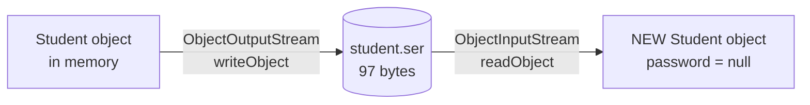
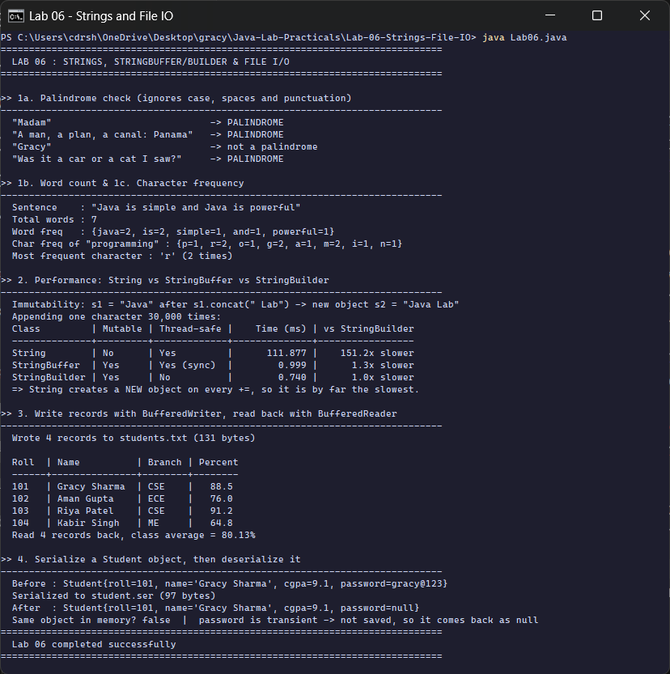

<div align="center">

# Lab 06 &nbsp;|&nbsp; Strings and File I/O

**String operations &nbsp;·&nbsp; String vs StringBuffer vs StringBuilder &nbsp;·&nbsp; BufferedWriter / BufferedReader &nbsp;·&nbsp; Serialization**


[&larr; Lab 05](../Lab-05-Exception-Handling/README.md) &nbsp;&nbsp;|&nbsp;&nbsp; [All labs](../../README.md) &nbsp;&nbsp;|&nbsp;&nbsp; [Lab 07 &rarr;](../Lab-07-Collections-Inventory/README.md)

</div>

---

## Aim

> Write programs to **(1)** perform String operations: palindrome check, word count, character frequency; **(2)** compare String, StringBuffer and StringBuilder performance; **(3)** write student records to a text file using `BufferedWriter` and read them back using `BufferedReader`; **(4)** serialize a `Student` object to a file and deserialize it back.

| Course Outcome | Bloom's Level | Relevance | Hours | Evaluation |
|:--|:--:|:--:|:--:|:--|
| **CO3** - Perform string operations and manage file input/output in Java | K3 - Apply | Global | 2 | Lab Tasks, Viva, Practical Record |

---

## Part 1 &nbsp;|&nbsp; String operations

| Operation | Technique | Example result |
|:--|:--|:--|
| Palindrome check | two pointers that **skip** spaces and punctuation, compare ignoring case | `"A man, a plan, a canal: Panama"` is a palindrome |
| Word count | `trim().split("\\s+")` (one or more spaces) | 7 words |
| Word frequency | `LinkedHashMap.merge(word, 1, Integer::sum)` | `java=2, is=2, ...` |
| Character frequency | same `merge` idea on `char`s, insertion order kept | `"programming"` &rarr; `r=2, g=2, m=2, ...` |

```java
static boolean isPalindrome(String s) {
    int i = 0, j = s.length() - 1;
    while (i < j) {
        char a = s.charAt(i), b = s.charAt(j);
        if (!Character.isLetterOrDigit(a)) { i++; continue; }   // skip punctuation
        if (!Character.isLetterOrDigit(b)) { j--; continue; }
        if (Character.toLowerCase(a) != Character.toLowerCase(b)) return false;
        i++; j--;
    }
    return true;
}
```

---

## Part 2 &nbsp;|&nbsp; String vs StringBuffer vs StringBuilder

Each class appends one character **30,000 times**. A short warm-up run happens first so the JIT compiler treats all three fairly.

```java
for (int i = 0; i < n; i++) str += "x";        // String: a NEW object every time
for (int i = 0; i < n; i++) sbf.append("x");   // StringBuffer: same object, synchronized
for (int i = 0; i < n; i++) sbd.append("x");   // StringBuilder: same object, not synchronized
```

| | `String` | `StringBuffer` | `StringBuilder` |
|:--|:--:|:--:|:--:|
| Mutable | no | yes | yes |
| Thread-safe | yes (immutable) | yes (`synchronized` methods) | no |
| Cost of `+=` / `append` | copies the whole text: **O(n)** | amortised **O(1)** | amortised **O(1)**, no locking |
| Measured in this run | **111.877 ms** | 0.999 ms | 0.740 ms |
| Use it for | fixed text | text shared by threads | text built in one thread (most cases) |

> In the recorded run, `String` was about **151 times slower** than `StringBuilder`. Building a 30,000-character string with `+=` copies roughly 450 million characters in total; `append` writes each character once. Exact timings change from run to run and machine to machine, but the gap is always large.

---

## Part 3 &nbsp;|&nbsp; Text file with buffered streams


```java
try (BufferedWriter bw = new BufferedWriter(new FileWriter(txt))) {   // auto-closed
    bw.write("roll,name,branch,percentage");
    bw.newLine();
    for (String r : records) { bw.write(r); bw.newLine(); }
}
```

The buffer collects characters in memory and writes them to disk in large blocks, which is much faster than one system call per character. **try-with-resources** closes (and flushes) the file automatically.

---

## Part 4 &nbsp;|&nbsp; Serialization

```java
class Student implements Serializable {
    private static final long serialVersionUID = 1L;
    private final int roll;
    private final String name;
    private final double cgpa;
    private final transient String password;     // sensitive -> never written to disk
}
```



| Keyword | Meaning |
|:--|:--|
| `Serializable` | marker interface (no methods) that allows the object to be turned into bytes |
| `serialVersionUID` | version number checked during deserialization, so an old file is not read into a changed class |
| `transient` | field is **skipped**; after reading back it gets its default value (`null`) |

---

## How to run

```bash
cd Java-Lab-Practicals/Lab-06-Strings-File-IO
java Lab06.java
```

<sub>The program creates `students.txt` and `student.ser` in this folder while it runs. They are runtime files, so they are listed in `.gitignore` and are not part of the submission.</sub>

---

## Output

<p align="center">
  
</p>

| Section | What the run shows |
|:--|:--|
| 1a | 3 of the 4 sentences are palindromes once punctuation and case are ignored |
| 1b / 1c | 7 words; `java` and `is` appear twice; `'r'` is the first of the characters that appear twice |
| 2 | the timing table: String about 151x slower than StringBuilder; `concat` returns a **new** string, `s1` is unchanged |
| 3 | 4 records written (131 bytes), read back and averaged to 80.13% |
| 4 | object restored from 97 bytes; `password` comes back `null` because it is `transient` |

<details>
<summary><b>Output as plain text</b> (for the practical record)</summary>

```text
==============================================================================
  LAB 06 : STRINGS, STRINGBUFFER/BUILDER & FILE I/O
==============================================================================

>> 1a. Palindrome check (ignores case, spaces and punctuation)
------------------------------------------------------------------------------
  "Madam"                            -> PALINDROME
  "A man, a plan, a canal: Panama"   -> PALINDROME
  "Gracy"                            -> not a palindrome
  "Was it a car or a cat I saw?"     -> PALINDROME

>> 1b. Word count & 1c. Character frequency
------------------------------------------------------------------------------
  Sentence    : "Java is simple and Java is powerful"
  Total words : 7
  Word freq   : {java=2, is=2, simple=1, and=1, powerful=1}
  Char freq of "programming" : {p=1, r=2, o=1, g=2, a=1, m=2, i=1, n=1}
  Most frequent character : 'r' (2 times)

>> 2. Performance: String vs StringBuffer vs StringBuilder
------------------------------------------------------------------------------
  Immutability: s1 = "Java" after s1.concat(" Lab") -> new object s2 = "Java Lab"
  Appending one character 30,000 times:
  Class         | Mutable | Thread-safe |    Time (ms) | vs StringBuilder
  --------------+---------+-------------+--------------+-----------------
  String        | No      | Yes         |      111.877 |    151.2x slower
  StringBuffer  | Yes     | Yes (sync)  |        0.999 |      1.3x slower
  StringBuilder | Yes     | No          |        0.740 |      1.0x slower
  => String creates a NEW object on every +=, so it is by far the slowest.

>> 3. Write records with BufferedWriter, read back with BufferedReader
------------------------------------------------------------------------------
  Wrote 4 records to students.txt (131 bytes)

  Roll  | Name          | Branch | Percent
  ------+---------------+--------+--------
  101   | Gracy Sharma  | CSE    |   88.5
  102   | Aman Gupta    | ECE    |   76.0
  103   | Riya Patel    | CSE    |   91.2
  104   | Kabir Singh   | ME     |   64.8
  Read 4 records back, class average = 80.13%

>> 4. Serialize a Student object, then deserialize it
------------------------------------------------------------------------------
  Before : Student{roll=101, name='Gracy Sharma', cgpa=9.1, password=gracy@123}
  Serialized to student.ser (97 bytes)
  After  : Student{roll=101, name='Gracy Sharma', cgpa=9.1, password=null}
  Same object in memory? false  |  password is transient -> not saved, so it comes back as null
==============================================================================
  Lab 06 completed successfully
==============================================================================
```

</details>

---

## Viva questions

<details>
<summary><b>1. Why is String immutable in Java?</b></summary>

For safety and speed: strings can be shared from the **string pool**, used as `HashMap` keys (the hash never changes), and passed between threads without locks. The cost is that every "change" creates a new object.
</details>

<details>
<summary><b>2. StringBuffer or StringBuilder?</b></summary>

`StringBuilder` in almost all code. `StringBuffer` has the same API but every method is `synchronized`, which only helps when several threads modify the **same** buffer.
</details>

<details>
<summary><b>3. What does <code>transient</code> do?</b></summary>

It tells serialization to skip the field. Use it for passwords, caches, or anything that should not be saved or cannot be serialized.
</details>

<details>
<summary><b>4. What happens if a class is not <code>Serializable</code>?</b></summary>

`writeObject` throws `java.io.NotSerializableException` at runtime.
</details>

<details>
<summary><b>5. Why use BufferedReader instead of FileReader alone?</b></summary>

`BufferedReader` reads big blocks into memory and offers `readLine()`. Plain `FileReader` reads character by character, which means many slow disk calls.
</details>

---

## Result

String operations, the String / StringBuffer / StringBuilder performance comparison, buffered text file I/O and object serialization were implemented and executed on **OpenJDK 17**, and the output was verified.

<div align="center">

[&larr; Lab 05](../Lab-05-Exception-Handling/README.md) &nbsp;&nbsp;|&nbsp;&nbsp; [All labs](../../README.md) &nbsp;&nbsp;|&nbsp;&nbsp; [Lab 07 &rarr;](../Lab-07-Collections-Inventory/README.md)

</div>
