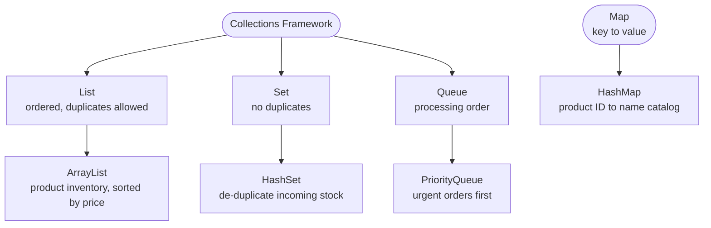
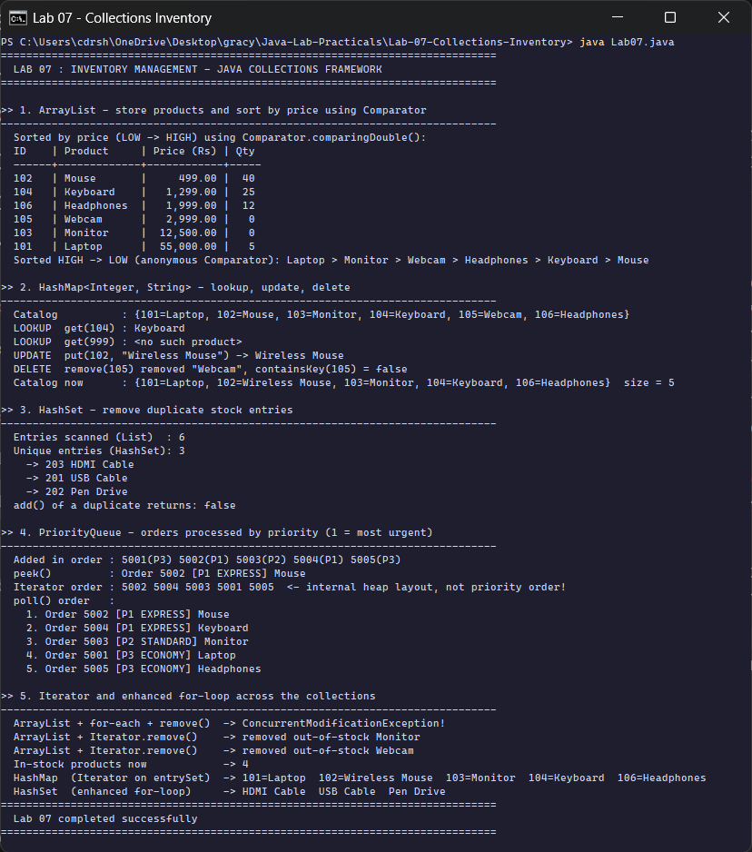

<div align="center">

# Lab 07 &nbsp;|&nbsp; Inventory Management System

**ArrayList + Comparator &nbsp;·&nbsp; HashMap &nbsp;·&nbsp; HashSet &nbsp;·&nbsp; PriorityQueue &nbsp;·&nbsp; Iterator**


[&larr; Lab 06](../Lab-06-Strings-File-IO/README.md) &nbsp;&nbsp;|&nbsp;&nbsp; [All labs](../../README.md) &nbsp;&nbsp;|&nbsp;&nbsp; [Lab 08 &rarr;](../Lab-08-Streams-Optional-Threads/README.md)

</div>

---

## Aim

> Implement a simple inventory management system using **(1)** `ArrayList` to store and sort products by price using `Comparator`; **(2)** `HashMap` to store product ID-name pairs with lookup, update, delete; **(3)** `HashSet` to remove duplicate entries; **(4)** `PriorityQueue` to process orders by priority. Demonstrate **Iterator and enhanced for-loop** across all collections.

| Course Outcome | Bloom's Level | Relevance | Hours | Evaluation |
|:--|:--:|:--:|:--:|:--|
| **CO4** - Utilize Java Collections Framework for data management | K3 - Apply | Global | 2 | Lab Tasks, Viva, Practical Record |

---

## Which collection, and why



| Collection | Job in this system | Key operations | Typical cost |
|:--|:--|:--|:--|
| `ArrayList<Product>` | the inventory | `add`, `sort(Comparator)` | get O(1), sort O(n log n) |
| `HashMap<Integer, String>` | ID to name catalog | `put`, `get`, `getOrDefault`, `remove`, `containsKey` | O(1) average |
| `HashSet<Product>` | remove duplicate stock entries | constructor from a list, `add` returns `false` on duplicates | O(1) average |
| `PriorityQueue<Order>` | process orders by urgency | `add`, `peek`, `poll` | add / poll O(log n) |

---

## Code walkthrough

### 1. Sorting with `Comparator`, two styles

```java
// modern: a Comparator built from a method reference
inventory.sort(Comparator.comparingDouble(Product::getPrice));

// classic: an anonymous class
inventory.sort(new Comparator<Product>() {
    @Override
    public int compare(Product a, Product b) {
        return Double.compare(b.getPrice(), a.getPrice());          // descending
    }
});
```

### 2. HashMap CRUD

```java
catalog.get(104);                              // LOOKUP  -> "Keyboard"
catalog.getOrDefault(999, "<no such product>");// LOOKUP with a safe default
catalog.put(102, "Wireless Mouse");            // UPDATE an existing key
catalog.remove(105);                           // DELETE, returns the removed value
```

### 3. HashSet needs `equals()` and `hashCode()`

```java
@Override
public boolean equals(Object o) { ... return id == p.id && name.equals(p.name); }

@Override
public int hashCode() { return Objects.hash(id, name); }
```

Without these two methods, every `new Product(...)` would count as different and the set would keep all 6 entries. With them, 6 scanned entries become **3 unique** products.

### 4. PriorityQueue with a two-level Comparator

```java
PriorityQueue<Order> orders = new PriorityQueue<>(
        Comparator.comparingInt(Order::priority).thenComparingInt(Order::id));
```

Priority 1 (EXPRESS) comes out first; ties are broken by order ID. Note from the output: **iterating** a `PriorityQueue` shows its internal heap layout, **not** the priority order. Only `poll()` guarantees the order.

### 5. Iterator vs enhanced for-loop

```java
for (Product p : scratch) if (p.getQty() == 0) scratch.remove(p);   // throws ConcurrentModificationException

Iterator<Product> it = inventory.iterator();
while (it.hasNext()) {
    Product p = it.next();
    if (p.getQty() == 0) it.remove();                                 // the safe way
}
```

The for-each loop uses a hidden iterator; removing through the list behind its back makes it **fail fast**. `Iterator.remove()` keeps the iterator in sync.

---

## How to run

```bash
cd Java-Lab-Practicals/Lab-07-Collections-Inventory
java Lab07.java
```

---

## Output

<p align="center">
  
</p>

| Section | What the run shows |
|:--|:--|
| 1. ArrayList | 6 products sorted LOW to HIGH (Mouse Rs. 499 first), then HIGH to LOW with the anonymous comparator |
| 2. HashMap | lookup, safe default for a missing ID, update of 102, delete of 105, final size 5 |
| 3. HashSet | 6 scanned entries reduced to 3; adding a duplicate returns `false` |
| 4. PriorityQueue | iterator order `5002 5004 5003 5001 5005` differs from poll order: P1, P1, P2, P3, P3 |
| 5. Iteration | for-each removal fails with `ConcurrentModificationException`; `Iterator.remove()` safely removes Monitor and Webcam |

<details>
<summary><b>Output as plain text</b> (for the practical record)</summary>

```text
==============================================================================
  LAB 07 : INVENTORY MANAGEMENT - JAVA COLLECTIONS FRAMEWORK
==============================================================================

>> 1. ArrayList - store products and sort by price using Comparator
------------------------------------------------------------------------------
  Sorted by price (LOW -> HIGH) using Comparator.comparingDouble():
  ID    | Product     | Price (Rs) | Qty
  ------+-------------+------------+-----
  102   | Mouse       |     499.00 |  40
  104   | Keyboard    |   1,299.00 |  25
  106   | Headphones  |   1,999.00 |  12
  105   | Webcam      |   2,999.00 |   0
  103   | Monitor     |  12,500.00 |   0
  101   | Laptop      |  55,000.00 |   5
  Sorted HIGH -> LOW (anonymous Comparator): Laptop > Monitor > Webcam > Headphones > Keyboard > Mouse

>> 2. HashMap<Integer, String> - lookup, update, delete
------------------------------------------------------------------------------
  Catalog          : {101=Laptop, 102=Mouse, 103=Monitor, 104=Keyboard, 105=Webcam, 106=Headphones}
  LOOKUP  get(104) : Keyboard
  LOOKUP  get(999) : <no such product>
  UPDATE  put(102, "Wireless Mouse") -> Wireless Mouse
  DELETE  remove(105) removed "Webcam", containsKey(105) = false
  Catalog now      : {101=Laptop, 102=Wireless Mouse, 103=Monitor, 104=Keyboard, 106=Headphones}  size = 5

>> 3. HashSet - remove duplicate stock entries
------------------------------------------------------------------------------
  Entries scanned (List)  : 6
  Unique entries (HashSet): 3
    -> 203 HDMI Cable
    -> 201 USB Cable
    -> 202 Pen Drive
  add() of a duplicate returns: false

>> 4. PriorityQueue - orders processed by priority (1 = most urgent)
------------------------------------------------------------------------------
  Added in order : 5001(P3) 5002(P1) 5003(P2) 5004(P1) 5005(P3)
  peek()         : Order 5002 [P1 EXPRESS] Mouse
  Iterator order : 5002 5004 5003 5001 5005  <- internal heap layout, not priority order!
  poll() order   :
    1. Order 5002 [P1 EXPRESS] Mouse
    2. Order 5004 [P1 EXPRESS] Keyboard
    3. Order 5003 [P2 STANDARD] Monitor
    4. Order 5001 [P3 ECONOMY] Laptop
    5. Order 5005 [P3 ECONOMY] Headphones

>> 5. Iterator and enhanced for-loop across the collections
------------------------------------------------------------------------------
  ArrayList + for-each + remove()  -> ConcurrentModificationException!
  ArrayList + Iterator.remove()    -> removed out-of-stock Monitor
  ArrayList + Iterator.remove()    -> removed out-of-stock Webcam
  In-stock products now            -> 4
  HashMap  (Iterator on entrySet)  -> 101=Laptop  102=Wireless Mouse  103=Monitor  104=Keyboard  106=Headphones
  HashSet  (enhanced for-loop)     -> HDMI Cable  USB Cable  Pen Drive
==============================================================================
  Lab 07 completed successfully
==============================================================================
```

</details>

---

## Viva questions

<details>
<summary><b>1. Comparable vs Comparator?</b></summary>

`Comparable` gives a class **one natural order** through `compareTo()` inside the class. `Comparator` is a separate object, so you can have **many orders** (by price, by name, descending) without changing the class.
</details>

<details>
<summary><b>2. How does HashSet detect duplicates?</b></summary>

It first uses `hashCode()` to find the bucket, then `equals()` to compare with the objects in that bucket. That is why both must be overridden together, and equal objects must return the same hash code.
</details>

<details>
<summary><b>3. HashMap vs TreeMap?</b></summary>

`HashMap` has O(1) average operations and no ordering. `TreeMap` keeps keys sorted with O(log n) operations. This program prints the catalog through `new TreeMap<>(catalog)` only to show the IDs in order.
</details>

<details>
<summary><b>4. What is a fail-fast iterator?</b></summary>

An iterator that throws `ConcurrentModificationException` as soon as it notices the collection was structurally changed by something other than the iterator itself (it checks an internal `modCount`).
</details>

<details>
<summary><b>5. How is a PriorityQueue stored internally?</b></summary>

As a **binary min-heap** in an array. The smallest element (by the comparator) is always at the root, so `peek()` is O(1) and `poll()` is O(log n), but the rest of the array is only partially ordered.
</details>

---

## Result

The inventory management system was implemented with `ArrayList`, `HashMap`, `HashSet` and `PriorityQueue`, traversed with both `Iterator` and the enhanced for-loop, and executed on **OpenJDK 17**. All operations produced the expected output.

<div align="center">

[&larr; Lab 06](../Lab-06-Strings-File-IO/README.md) &nbsp;&nbsp;|&nbsp;&nbsp; [All labs](../../README.md) &nbsp;&nbsp;|&nbsp;&nbsp; [Lab 08 &rarr;](../Lab-08-Streams-Optional-Threads/README.md)

</div>
