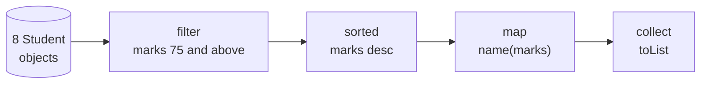
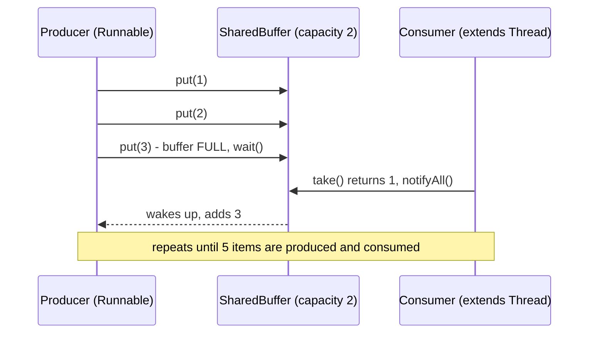
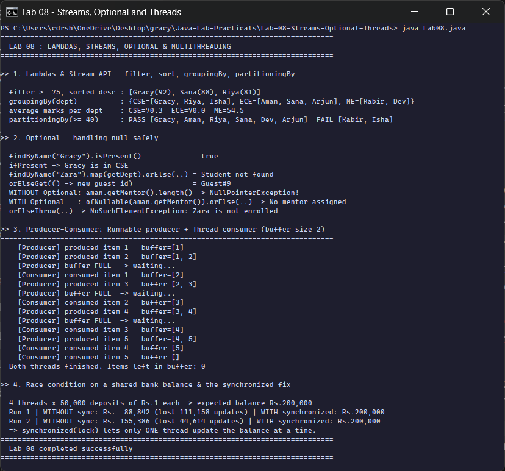

<div align="center">

# Lab 08 &nbsp;|&nbsp; Java 8 Features and Multithreading

**Lambdas + Stream API &nbsp;·&nbsp; Optional &nbsp;·&nbsp; Producer-Consumer &nbsp;·&nbsp; Race conditions and `synchronized`**


[&larr; Lab 07](../Lab-07-Collections-Inventory/README.md) &nbsp;&nbsp;|&nbsp;&nbsp; [All labs](../../README.md) &nbsp;&nbsp;|&nbsp;&nbsp; [Lab 09 &rarr;](../Lab-09-JDBC-CRUD/README.md)

</div>

---

## Aim

> Write programs to **(1)** use Lambda expressions and Stream API to filter, sort and group student objects using `groupingBy` and `partitioningBy`; **(2)** demonstrate `Optional` to handle null safely; **(3)** simulate producer-consumer using the `Thread` class and the `Runnable` interface; **(4)** use a `synchronized` block to prevent race conditions on a shared bank account balance.

| Course Outcome | Bloom's Level | Relevance | Hours | Evaluation |
|:--|:--:|:--:|:--:|:--|
| **CO4** - Apply Java 8 features and implement multithreaded programs | K4 - Analyze | Global | 2 | Lab Tasks, Viva, Practical Record |

---

## Part 1 &nbsp;|&nbsp; Lambdas and the Stream API

A stream is a **pipeline**: a source, zero or more intermediate steps, and one terminal step that produces the result.



```java
List<String> toppers = students.stream()
        .filter(s -> s.getMarks() >= 75)                                  // lambda predicate
        .sorted(Comparator.comparingInt(Student::getMarks).reversed())   // sort high -> low
        .map(s -> s.getName() + "(" + s.getMarks() + ")")
        .collect(Collectors.toList());

Map<String, List<String>> byDept = students.stream()
        .collect(Collectors.groupingBy(Student::getDept, TreeMap::new,
                 Collectors.mapping(Student::getName, Collectors.toList())));

Map<Boolean, List<String>> passFail = students.stream()
        .collect(Collectors.partitioningBy(s -> s.getMarks() >= 40,
                 Collectors.mapping(Student::getName, Collectors.toList())));
```

| Collector | Groups into | Keys |
|:--|:--|:--|
| `groupingBy(classifier)` | any number of groups | whatever the classifier returns (`CSE`, `ECE`, `ME`) |
| `partitioningBy(predicate)` | **exactly two** groups | `true` and `false` (always both present) |
| `averagingInt(...)` as downstream | one number per group | used for the average marks per department |

---

## Part 2 &nbsp;|&nbsp; Optional, null-safety without `if (x != null)`

```java
Student aman = findByName(students, "Aman").get();
aman.getMentor().length();                                         // NullPointerException: mentor is null

String mentor = Optional.ofNullable(aman.getMentor())
                        .orElse("No mentor assigned");             // safe
```

| Method | Behaviour when empty |
|:--|:--|
| `isPresent()` / `ifPresent(action)` | `false` / action skipped |
| `map(fn)` | stays empty, `fn` never runs |
| `orElse(value)` | returns the default (always evaluated) |
| `orElseGet(supplier)` | calls the supplier **only** when empty (lazy) |
| `orElseThrow(supplier)` | throws the exception you choose |

---

## Part 3 &nbsp;|&nbsp; Producer-Consumer with `wait()` / `notifyAll()`

The **producer** is a `Runnable` passed to a `Thread`; the **consumer** `extends Thread`. They share a buffer that holds at most **2** items. The producer is fast (40 ms), the consumer is slow (120 ms), so the producer regularly finds the buffer full and has to wait.



```java
synchronized void put(int item) throws InterruptedException {
    while (queue.size() == capacity) {
        System.out.println("    [Producer] buffer FULL  -> waiting...");
        wait();                                 // releases the lock and sleeps
    }
    queue.add(item);
    notifyAll();                                // wake up the consumer
}
```

`wait()` is called inside a **`while`** loop, not an `if`, so a thread that wakes up re-checks the condition before continuing.

---

## Part 4 &nbsp;|&nbsp; Race condition and the `synchronized` block

`balance = balance + amount` is **three** steps (read, add, write). Two threads can read the same old value, and one update is lost.

| Time | Thread A | Thread B | balance |
|:-:|:--|:--|:-:|
| 1 | reads 100 | | 100 |
| 2 | | reads 100 | 100 |
| 3 | writes 101 | | 101 |
| 4 | | writes 101 | **101** (should be 102) |

```java
void depositUnsafe(int amount) {
    balance = balance + amount;                 // read-modify-write can interleave
}

void depositSafe(int amount) {
    synchronized (lock) {                       // only ONE thread at a time
        balance = balance + amount;
    }
}
```

4 threads each deposit Rs. 1 fifty thousand times, so the correct final balance is **Rs. 200,000**.

| Run (recorded) | Without `synchronized` | Lost updates | With `synchronized` |
|:-:|--:|--:|--:|
| 1 | Rs. 88,842 | 111,158 | **Rs. 200,000** |
| 2 | Rs. 155,386 | 44,614 | **Rs. 200,000** |

The unsafe numbers are different every run (that unpredictability is exactly the bug). The synchronized result is always 200,000.

---

## How to run

```bash
cd Java-Lab-Practicals/Lab-08-Streams-Optional-Threads
java Lab08.java
```

---

## Output

<p align="center">
  
</p>

| Section | What the run shows |
|:--|:--|
| 1. Streams | toppers `[Gracy(92), Sana(88), Riya(81)]`, groups by department, averages, PASS 6 / FAIL 2 |
| 2. Optional | present and empty cases, lazy `orElseGet`, the `NullPointerException` avoided, `orElseThrow` |
| 3. Producer-Consumer | buffer fills to `[1, 2]`, producer waits 3 times, consumer drains it to `[]` |
| 4. Race condition | lost updates without the lock, an exact Rs. 200,000 with `synchronized` |

<details>
<summary><b>Output as plain text</b> (for the practical record)</summary>

```text
==============================================================================
  LAB 08 : LAMBDAS, STREAMS, OPTIONAL & MULTITHREADING
==============================================================================

>> 1. Lambdas & Stream API - filter, sort, groupingBy, partitioningBy
------------------------------------------------------------------------------
  filter >= 75, sorted desc : [Gracy(92), Sana(88), Riya(81)]
  groupingBy(dept)          : {CSE=[Gracy, Riya, Isha], ECE=[Aman, Sana, Arjun], ME=[Kabir, Dev]}
  average marks per dept    : CSE=70.3  ECE=70.0  ME=54.5
  partitioningBy(>= 40)     : PASS [Gracy, Aman, Riya, Sana, Dev, Arjun]  FAIL [Kabir, Isha]

>> 2. Optional - handling null safely
------------------------------------------------------------------------------
  findByName("Gracy").isPresent()            = true
  ifPresent -> Gracy is in CSE
  findByName("Zara").map(getDept).orElse(..) = Student not found
  orElseGet(() -> new guest id)              = Guest#9
  WITHOUT Optional: aman.getMentor().length() -> NullPointerException!
  WITH Optional   : ofNullable(aman.getMentor()).orElse(..) -> No mentor assigned
  orElseThrow(..) -> NoSuchElementException: Zara is not enrolled

>> 3. Producer-Consumer: Runnable producer + Thread consumer (buffer size 2)
------------------------------------------------------------------------------
    [Producer] produced item 1   buffer=[1]
    [Producer] produced item 2   buffer=[1, 2]
    [Producer] buffer FULL  -> waiting...
    [Consumer] consumed item 1   buffer=[2]
    [Producer] produced item 3   buffer=[2, 3]
    [Producer] buffer FULL  -> waiting...
    [Consumer] consumed item 2   buffer=[3]
    [Producer] produced item 4   buffer=[3, 4]
    [Producer] buffer FULL  -> waiting...
    [Consumer] consumed item 3   buffer=[4]
    [Producer] produced item 5   buffer=[4, 5]
    [Consumer] consumed item 4   buffer=[5]
    [Consumer] consumed item 5   buffer=[]
  Both threads finished. Items left in buffer: 0

>> 4. Race condition on a shared bank balance & the synchronized fix
------------------------------------------------------------------------------
  4 threads x 50,000 deposits of Rs.1 each -> expected balance Rs.200,000
  Run 1 | WITHOUT sync: Rs.  88,842 (lost 111,158 updates) | WITH synchronized: Rs.200,000
  Run 2 | WITHOUT sync: Rs. 155,386 (lost 44,614 updates) | WITH synchronized: Rs.200,000
  => synchronized(lock) lets only ONE thread update the balance at a time.
==============================================================================
  Lab 08 completed successfully
==============================================================================
```

</details>

---

## Viva questions

<details>
<summary><b>1. What is a functional interface? Give examples from this lab.</b></summary>

An interface with exactly **one abstract method**, so a lambda can implement it. In this lab: `Predicate` (in `filter` and `partitioningBy`), `Function` (in `map`), `Comparator`, `Supplier` (in `orElseGet`) and `Runnable` (the deposit jobs).
</details>

<details>
<summary><b>2. Are streams lazy?</b></summary>

Yes. Intermediate operations (`filter`, `map`, `sorted`) do nothing until a terminal operation (`collect`, `forEach`, `findFirst`) runs. A stream can also be consumed only once.
</details>

<details>
<summary><b>3. Thread class or Runnable interface?</b></summary>

Prefer `Runnable`: the class can still extend something else, and the task is separate from the thread that runs it (it can also go to an `ExecutorService`). This lab shows both on purpose.
</details>

<details>
<summary><b>4. Why must <code>wait()</code> and <code>notify()</code> be called inside synchronized code?</b></summary>

They work on the object's monitor lock. Calling them without holding the lock throws `IllegalMonitorStateException`. `wait()` releases the lock while sleeping and takes it back before returning.
</details>

<details>
<summary><b>5. <code>sleep()</code> vs <code>wait()</code>?</b></summary>

`Thread.sleep()` pauses without releasing any lock. `wait()` releases the monitor and waits until another thread calls `notify()` / `notifyAll()`.
</details>

<details>
<summary><b>6. Other ways to fix the race condition?</b></summary>

A `synchronized` method, `ReentrantLock`, or an atomic class such as `AtomicInteger.incrementAndGet()` / `LongAdder`.
</details>

---

## Result

Lambda expressions, the Stream API (`groupingBy`, `partitioningBy`), `Optional`, a producer-consumer simulation with `Thread` and `Runnable`, and a race condition fixed with a `synchronized` block were implemented and executed on **OpenJDK 17**. The output was analysed and verified.

<div align="center">

[&larr; Lab 07](../Lab-07-Collections-Inventory/README.md) &nbsp;&nbsp;|&nbsp;&nbsp; [All labs](../../README.md) &nbsp;&nbsp;|&nbsp;&nbsp; [Lab 09 &rarr;](../Lab-09-JDBC-CRUD/README.md)

</div>
