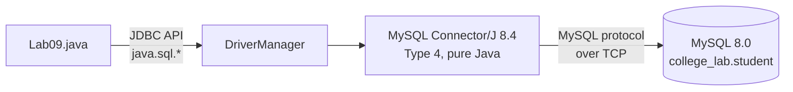
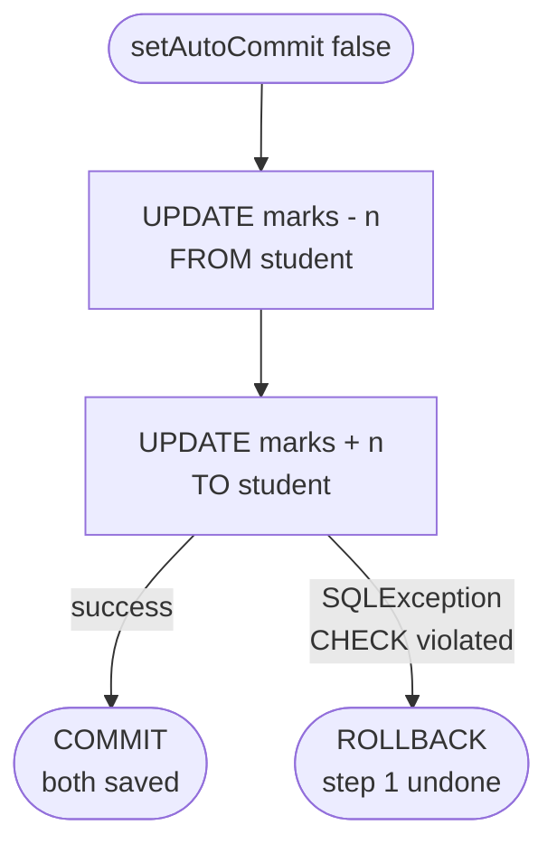
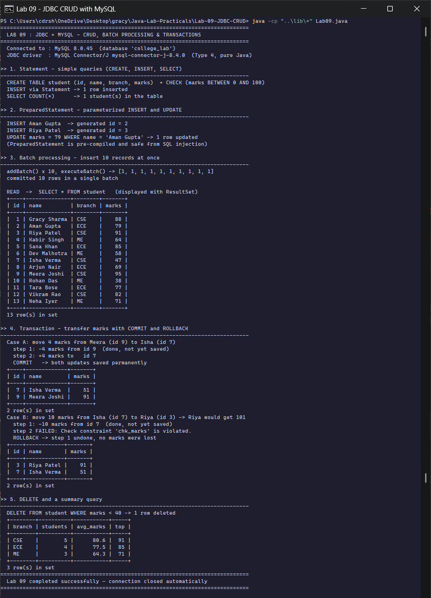

<div align="center">

# Lab 09 &nbsp;|&nbsp; JDBC with MySQL

**Statement &nbsp;·&nbsp; PreparedStatement &nbsp;·&nbsp; Batch processing &nbsp;·&nbsp; Transactions &nbsp;·&nbsp; ResultSet**


[&larr; Lab 08](../Lab-08-Streams-Optional-Threads/README.md) &nbsp;&nbsp;|&nbsp;&nbsp; [All labs](../../README.md) &nbsp;&nbsp;|&nbsp;&nbsp; [Lab 10 &rarr;](../Lab-10-Advanced-JDBC-Records-Sealed/README.md)

</div>

---

## Aim

> Connect a Java application to MySQL. Create a `student` table and implement **full CRUD** using **(1)** `Statement` for simple queries; **(2)** `PreparedStatement` for parameterized insert and update; **(3)** batch processing to insert 10 records at once; **(4)** transaction management: transfer marks between records with **commit and rollback on failure**. Display results using `ResultSet`.

| Course Outcome | Bloom's Level | Relevance | Hours | Evaluation |
|:--|:--:|:--:|:--:|:--|
| **CO5** - Develop database-connected Java applications using JDBC | K4 - Analyze | Global | 2 | Lab Tasks, Viva, Practical Record |

---

## How JDBC connects Java to MySQL



**Table used**

```sql
CREATE TABLE student (
    id     INT PRIMARY KEY AUTO_INCREMENT,
    name   VARCHAR(40) NOT NULL,
    branch VARCHAR(10) NOT NULL,
    marks  INT NOT NULL,
    CONSTRAINT chk_marks CHECK (marks BETWEEN 0 AND 100)
);
```

The `CHECK` constraint is what makes the failed transfer in Part 4 fail **inside the database**, so the rollback is real.

---

## CRUD map

| Operation | JDBC object | SQL |
|:--|:--|:--|
| **C**reate | `Statement`, `PreparedStatement`, batch | `INSERT INTO student ...` |
| **R**ead | `Statement` + `ResultSet` | `SELECT ... FROM student` |
| **U**pdate | `PreparedStatement`, transaction | `UPDATE student SET marks = ? WHERE ...` |
| **D**elete | `PreparedStatement` | `DELETE FROM student WHERE marks < ?` |

---

## Code walkthrough

### 1. Statement: fixed SQL

```java
try (Statement st = con.createStatement()) {
    int rows = st.executeUpdate("INSERT INTO student (name, branch, marks) VALUES ('Gracy Sharma', 'CSE', 88)");
    try (ResultSet rs = st.executeQuery("SELECT COUNT(*) AS total FROM student")) { ... }
}
```

### 2. PreparedStatement: parameters with `?`

```java
String insertSql = "INSERT INTO student (name, branch, marks) VALUES (?, ?, ?)";
try (PreparedStatement ps = con.prepareStatement(insertSql, Statement.RETURN_GENERATED_KEYS)) {
    ps.setString(1, "Aman Gupta");               // ? number 1
    ps.setString(2, "ECE");                      // ? number 2
    ps.setInt(3, 72);                            // ? number 3
    ps.executeUpdate();
    ps.getGeneratedKeys();                       // the AUTO_INCREMENT id MySQL assigned
}
```

Values are sent **separately** from the SQL text, so input like `' OR 1=1 --` is treated as data, never as SQL. This is the standard defence against **SQL injection**, and the statement is pre-compiled once and reused.

### 3. Batch processing

```java
con.setAutoCommit(false);                        // send the batch as one unit
for (Object[] d : batch) {
    ps.setString(1, ...); ps.setString(2, ...); ps.setInt(3, ...);
    ps.addBatch();                               // queue it, do not run yet
}
int[] counts = ps.executeBatch();                // run all 10 together
con.commit();
```

`executeBatch()` returns one update count per queued statement: `[1, 1, 1, 1, 1, 1, 1, 1, 1, 1]`.

### 4. Transaction: transfer marks, all or nothing



```java
con.setAutoCommit(false);                                // BEGIN TRANSACTION
try (...) {
    debit.executeUpdate();                               // step 1
    credit.executeUpdate();                              // step 2 - may break the CHECK constraint
    con.commit();
} catch (SQLException e) {
    con.rollback();                                      // undo step 1 as well
} finally {
    con.setAutoCommit(true);
}
```

| Case | Transfer | Outcome |
|:--|:--|:--|
| A | 4 marks: Meera (95) to Isha (47) | **COMMIT**: Meera 91, Isha 51 |
| B | 10 marks: Isha (51) to Riya (91) | Riya would reach 101, MySQL says `Check constraint 'chk_marks' is violated`, **ROLLBACK**: Isha keeps 51 |

### 5. Displaying any ResultSet as a table

`printQuery()` reads column names from `ResultSetMetaData`, walks the rows with `rs.next()`, measures column widths and prints a MySQL-style table, so the same method displays every query in this lab.

---

## How to run

**Requirements:** JDK 17+, a running MySQL 8 server. The JDBC driver is already in [`../lib`](../lib).

```bash
cd Java-Lab-Practicals/Lab-09-JDBC-CRUD
java -cp "..\lib\*" Lab09.java          # Windows
java -cp "../lib/*" Lab09.java          # Linux / macOS
```

The program creates the `college_lab` database if it is missing. Default login is `root` / `root` on `localhost:3306`; to use different settings, set environment variables first:

```powershell
$env:DB_URL  = "jdbc:mysql://localhost:3306/college_lab?createDatabaseIfNotExist=true&allowPublicKeyRetrieval=true"
$env:DB_USER = "root"
$env:DB_PASS = "your-password"
```

---

## Output

<p align="center">
  
</p>

| Section | What the run shows |
|:--|:--|
| Connection | MySQL 8.0.45 and MySQL Connector/J 8.4.0 (a Type 4 driver) |
| 1. Statement | table created with the CHECK constraint, 1 row inserted, `COUNT(*) = 1` |
| 2. PreparedStatement | generated ids 2 and 3, Aman's marks updated to 79 |
| 3. Batch | 10 rows in one `executeBatch()`, then all 13 rows read through a `ResultSet` |
| 4. Transaction | Case A committed; Case B rejected by MySQL and rolled back, nothing lost |
| 5. Delete + summary | 1 student below 40 deleted, then `GROUP BY branch` averages |

<details>
<summary><b>Output as plain text</b> (for the practical record)</summary>

```text
==============================================================================
  LAB 09 : JDBC + MYSQL - CRUD, BATCH PROCESSING & TRANSACTIONS
==============================================================================
  Connected to : MySQL 8.0.45  (database 'college_lab')
  JDBC driver  : MySQL Connector/J mysql-connector-j-8.4.0  (Type 4, pure Java)

>> 1. Statement - simple queries (CREATE, INSERT, SELECT)
------------------------------------------------------------------------------
  CREATE TABLE student (id, name, branch, marks)  + CHECK (marks BETWEEN 0 AND 100)
  INSERT via Statement -> 1 row inserted
  SELECT COUNT(*)      -> 1 student(s) in the table

>> 2. PreparedStatement - parameterized INSERT and UPDATE
------------------------------------------------------------------------------
  INSERT Aman Gupta  -> generated id = 2
  INSERT Riya Patel  -> generated id = 3
  UPDATE marks = 79 WHERE name = 'Aman Gupta' -> 1 row updated
  (PreparedStatement is pre-compiled and safe from SQL injection)

>> 3. Batch processing - insert 10 records at once
------------------------------------------------------------------------------
  addBatch() x 10, executeBatch() -> [1, 1, 1, 1, 1, 1, 1, 1, 1, 1]
  committed 10 rows in a single batch

  READ  ->  SELECT * FROM student   (displayed with ResultSet)
  +----+--------------+--------+-------+
  | id | name         | branch | marks |
  +----+--------------+--------+-------+
  |  1 | Gracy Sharma | CSE    |    88 |
  |  2 | Aman Gupta   | ECE    |    79 |
  |  3 | Riya Patel   | CSE    |    91 |
  |  4 | Kabir Singh  | ME     |    64 |
  |  5 | Sana Khan    | ECE    |    85 |
  |  6 | Dev Malhotra | ME     |    58 |
  |  7 | Isha Verma   | CSE    |    47 |
  |  8 | Arjun Nair   | ECE    |    69 |
  |  9 | Meera Joshi  | CSE    |    95 |
  | 10 | Rohan Das    | ME     |    38 |
  | 11 | Tara Bose    | ECE    |    77 |
  | 12 | Vikram Rao   | CSE    |    82 |
  | 13 | Neha Iyer    | ME     |    71 |
  +----+--------------+--------+-------+
  13 row(s) in set

>> 4. Transaction - transfer marks with COMMIT and ROLLBACK
------------------------------------------------------------------------------
  Case A: move 4 marks from Meera (id 9) to Isha (id 7)
    step 1: -4 marks from id 9  (done, not yet saved)
    step 2: +4 marks to   id 7
    COMMIT   -> both updates saved permanently
  +----+-------------+-------+
  | id | name        | marks |
  +----+-------------+-------+
  |  7 | Isha Verma  |    51 |
  |  9 | Meera Joshi |    91 |
  +----+-------------+-------+
  2 row(s) in set
  Case B: move 10 marks from Isha (id 7) to Riya (id 3) -> Riya would get 101
    step 1: -10 marks from id 7  (done, not yet saved)
    step 2 FAILED: Check constraint 'chk_marks' is violated.
    ROLLBACK -> step 1 undone, no marks were lost
  +----+------------+-------+
  | id | name       | marks |
  +----+------------+-------+
  |  3 | Riya Patel |    91 |
  |  7 | Isha Verma |    51 |
  +----+------------+-------+
  2 row(s) in set

>> 5. DELETE and a summary query
------------------------------------------------------------------------------
  DELETE FROM student WHERE marks < 40 -> 1 row deleted
  +--------+----------+-----------+-----+
  | branch | students | avg_marks | top |
  +--------+----------+-----------+-----+
  | CSE    |        5 |      80.6 |  91 |
  | ECE    |        4 |      77.5 |  85 |
  | ME     |        3 |      64.3 |  71 |
  +--------+----------+-----------+-----+
  3 row(s) in set
==============================================================================
  Lab 09 completed successfully - connection closed automatically
==============================================================================
```

</details>

---

## Viva questions

<details>
<summary><b>1. What are the main steps of a JDBC program?</b></summary>

(1) Load or register the driver (automatic since JDBC 4), (2) open a `Connection`, (3) create a `Statement` / `PreparedStatement`, (4) execute the SQL, (5) process the `ResultSet`, (6) close everything (here with try-with-resources).
</details>

<details>
<summary><b>2. <code>execute()</code>, <code>executeQuery()</code> or <code>executeUpdate()</code>?</b></summary>

`executeQuery()` for `SELECT` (returns a `ResultSet`), `executeUpdate()` for `INSERT` / `UPDATE` / `DELETE` / DDL (returns a row count), `execute()` when you do not know in advance (returns a boolean).
</details>

<details>
<summary><b>3. Why is PreparedStatement preferred over Statement?</b></summary>

It prevents SQL injection, is pre-compiled (faster when repeated), and handles quoting and data types for you.
</details>

<details>
<summary><b>4. What do the ACID properties mean for the marks transfer?</b></summary>

**Atomicity**: both updates happen or neither. **Consistency**: the CHECK constraint is never broken. **Isolation**: other sessions do not see the half-finished transfer. **Durability**: after `commit()` the change survives a crash.
</details>

<details>
<summary><b>5. What is auto-commit?</b></summary>

By default every statement is committed immediately. `setAutoCommit(false)` groups several statements into one transaction that you end with `commit()` or `rollback()`.
</details>

<details>
<summary><b>6. Why use batch processing?</b></summary>

It sends many statements in one network round-trip instead of one round-trip per row, which is much faster for bulk inserts.
</details>

---

## Result

A Java application was connected to MySQL 8.0 through JDBC (MySQL Connector/J 8.4) and executed on **OpenJDK 17**. Full CRUD with `Statement` and `PreparedStatement`, a 10-record batch insert, and a marks-transfer transaction with commit and rollback were implemented, and all results were displayed through `ResultSet` and verified.

<div align="center">

[&larr; Lab 08](../Lab-08-Streams-Optional-Threads/README.md) &nbsp;&nbsp;|&nbsp;&nbsp; [All labs](../../README.md) &nbsp;&nbsp;|&nbsp;&nbsp; [Lab 10 &rarr;](../Lab-10-Advanced-JDBC-Records-Sealed/README.md)

</div>
