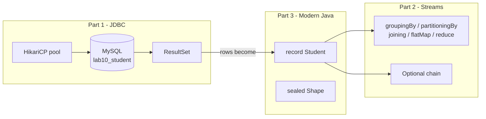
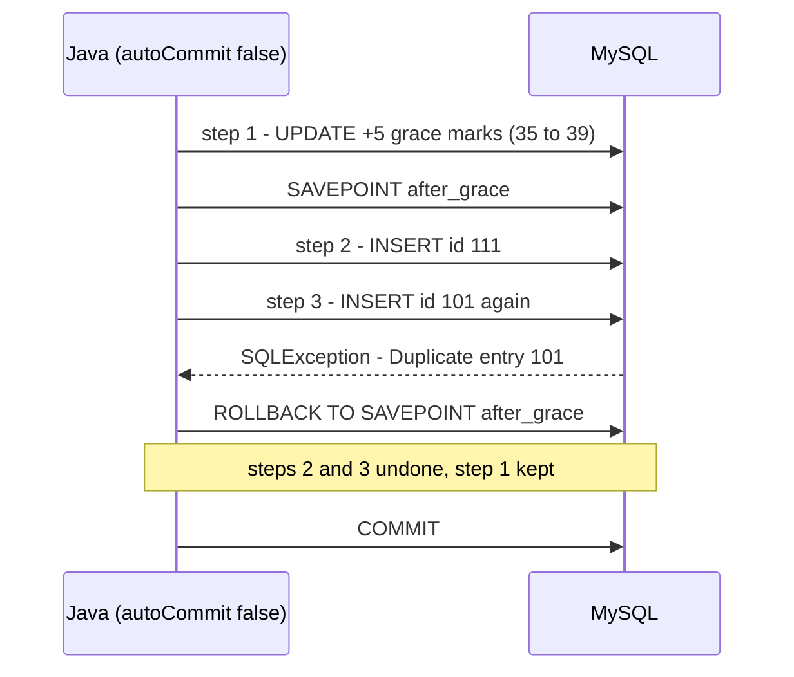
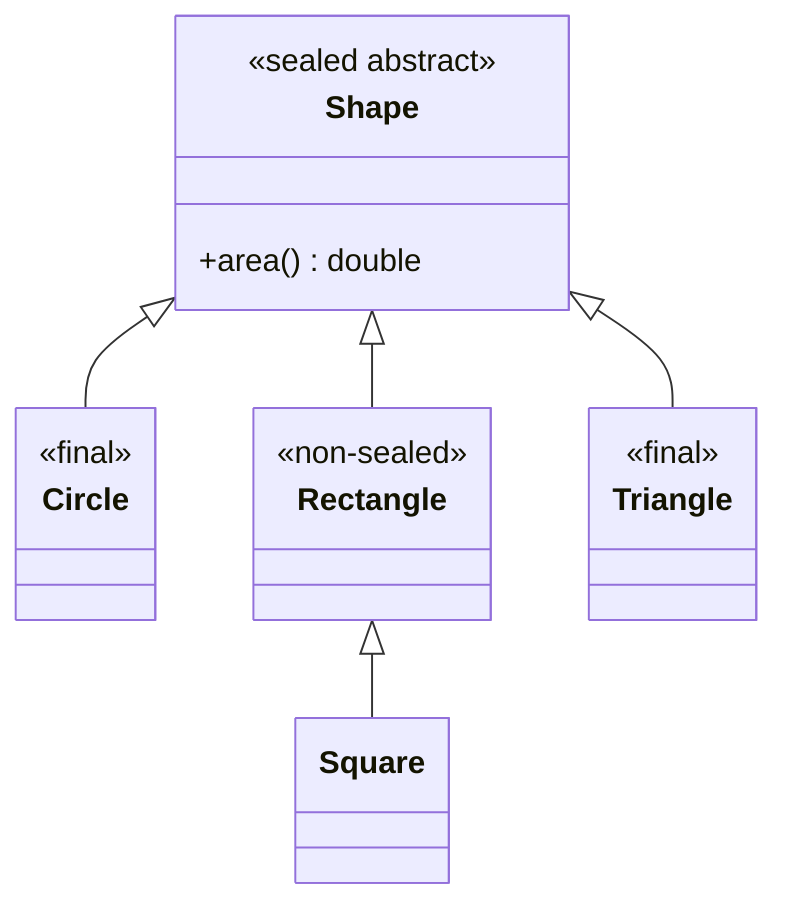
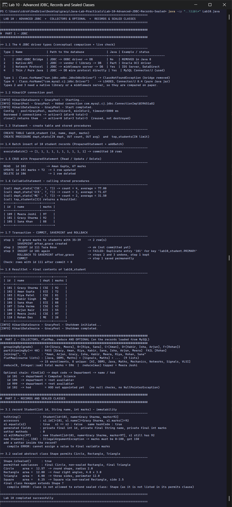

<div align="center">

# Lab 10 &nbsp;|&nbsp; Advanced JDBC, Modern Java

**4 driver types &nbsp;·&nbsp; HikariCP &nbsp;·&nbsp; CallableStatement &nbsp;·&nbsp; Savepoints &nbsp;·&nbsp; Collectors &nbsp;·&nbsp; Optional &nbsp;·&nbsp; Records &nbsp;·&nbsp; Sealed classes**


[&larr; Lab 09](../Lab-09-JDBC-CRUD/README.md) &nbsp;&nbsp;|&nbsp;&nbsp; [All labs](../../README.md)

</div>

---

## Aim

> Write programs to demonstrate:
> **(1) JDBC** - connect to MySQL using all 4 driver types (conceptual comparison); implement CRUD using `Statement`, `PreparedStatement` and `CallableStatement`; handle `ResultSet` to display records; perform batch insert of 10 student records; manage transactions with commit, rollback and savepoint; configure a HikariCP connection pool.
> **(2)** Use `Collectors.groupingBy()` to group students by grade, `partitioningBy()` to split pass/fail, `joining()` to concatenate names; demonstrate `flatMap` on a list of course lists and `reduce` to compute total marks; chain `Optional` methods to safely retrieve a student's department.
> **(3)** Create a **Record** class for `Student (id, name, marks)` and demonstrate immutability; define a **Sealed** class hierarchy `Shape` with permitted subclasses `Circle`, `Rectangle`, `Triangle`.

| Course Outcome | Bloom's Level | Relevance | Hours | Evaluation |
|:--|:--:|:--:|:--:|:--|
| **CO5** - Develop database-connected Java applications using JDBC and apply advanced Java 8+ and modern Java features including Records and Sealed classes | K4 - Analyze | Global | 2 | Lab Tasks, Viva, Practical Record |

---

## The big picture

The three parts are connected: rows written in Part 1 are read back from MySQL into `Student` **records**, and Part 2 runs its stream pipelines on exactly those records.



---

## Part 1 &nbsp;|&nbsp; JDBC

### 1.1 The four JDBC driver types

| Type | Name | Path to the database | Pure Java | Example / status |
|:-:|:--|:--|:-:|:--|
| 1 | JDBC-ODBC Bridge | JDBC &rarr; ODBC driver &rarr; DB | No | **Removed in Java 8** |
| 2 | Native-API | JDBC &rarr; vendor C library &rarr; DB | Partly | Oracle OCI driver |
| 3 | Network Protocol | JDBC &rarr; middleware server &rarr; DB | Yes | IDS Server, DataDirect |
| 4 | Thin / Pure Java | JDBC &rarr; database wire protocol directly | Yes | **MySQL Connector/J (used here)** |

The program does not just print this table, it **checks it live**: `Class.forName("sun.jdbc.odbc.JdbcOdbcDriver")` throws `ClassNotFoundException` on Java 17 (Type 1 is gone), while `Class.forName("com.mysql.cj.jdbc.Driver")` loads Connector/J 8.4 (Type 4). Types 2 and 3 need a native library or a middleware server that MySQL does not ship, so they are compared on paper.

### 1.2 HikariCP connection pool

Opening a database connection is slow (TCP handshake, login, SSL). A **pool** opens a few connections once and lends them out.

```java
HikariConfig cfg = new HikariConfig();
cfg.setJdbcUrl(URL);
cfg.setUsername(USER);
cfg.setPassword(PASS);
cfg.setPoolName("GracyPool");
cfg.setMaximumPoolSize(5);              // never more than 5 open connections
cfg.setMinimumIdle(2);                  // keep 2 ready even when idle
cfg.setConnectionTimeout(5_000);        // wait max 5 s for a free connection
```

`HikariPoolMXBean` proves the behaviour: after borrowing 3 connections it reports `active=3 idle=0 total=3`; after `close()` it reports `active=0 idle=3 total=3`. The connections went **back to the pool**, they were not destroyed.

### 1.3 to 1.6 &nbsp; Statement, PreparedStatement, CallableStatement

| Interface | Used for in this lab |
|:--|:--|
| `Statement` | `CREATE TABLE`, `CREATE PROCEDURE`, grace-mark `UPDATE`, final `SELECT` |
| `PreparedStatement` | batch insert of 10 records, READ / UPDATE / DELETE by id |
| `CallableStatement` | calling the stored procedures `dept_stats` (IN + 2 OUT parameters) and `top_students` (returns a `ResultSet`) |

```java
try (CallableStatement cs = con.prepareCall("{call dept_stats(?, ?, ?)}")) {
    cs.setString(1, "CSE");                              // IN
    cs.registerOutParameter(2, Types.INTEGER);           // OUT
    cs.registerOutParameter(3, Types.DECIMAL);           // OUT
    cs.execute();
    cs.getInt(2);  cs.getBigDecimal(3);                  // read the OUT values
}
```

### 1.7 Transaction with a savepoint



A plain `rollback()` would also have thrown away the grace marks. `rollback(savepoint)` undoes **only the work after the savepoint**. The program then checks that id 111 does not exist (`0` rows).

---

## Part 2 &nbsp;|&nbsp; Collectors, flatMap, reduce and Optional

```java
students.stream().collect(Collectors.groupingBy(Student::grade, TreeMap::new,
        Collectors.mapping(Lab10::firstName, Collectors.toList())));      // by grade A..F

students.stream().collect(Collectors.partitioningBy(s -> s.marks() >= 40, ...));  // pass / fail

students.stream().map(Lab10::firstName).sorted().collect(Collectors.joining(", "));

courseLists.stream().flatMap(List::stream).distinct().sorted()...;       // List<List<String>> -> List<String>

students.stream().map(Student::marks).reduce(0, Integer::sum);           // total marks
```

**`flatMap`** flattens the course lists into one stream of course names: `[[Java, DBMS, Maths], [Signals, Maths], ...]` becomes 15 enrollments and 8 unique courses.

**Optional chaining:** each step runs only if the previous one produced a value, so a missing student, a missing department code or an unknown department all end safely in the default value, with no `null` checks.

```java
String dept = findStudent(students, id)                  // Optional<Student>
        .map(s -> DEPT_CODE.get(s.id()))                 // Optional<String>
        .map(DEPARTMENTS::get)                           // Optional<Department>
        .map(Department::name)                           // Optional<String>
        .orElse("<not available>");
```

| Input | Where the chain stops | Result |
|:--|:--|:--|
| id 101 | nowhere | `Computer Science` |
| id 104 (dept `ME` not in the map) | `DEPARTMENTS::get` | `<not available>` |
| id 999 (no such student) | `findStudent` | `<not available>` |
| id 102, asking for the HOD (null) | `Department::hod` | `HOD not appointed yet` |

---

## Part 3 &nbsp;|&nbsp; Records and Sealed classes

### Record: an immutable data carrier

```java
record Student(int id, String name, int marks) {

    Student {                                            // compact constructor = validation
        if (marks < 0 || marks > 100) throw new IllegalArgumentException("marks must be 0-100, got " + marks);
        Objects.requireNonNull(name, "name");
    }

    Student withMarks(int newMarks) { return new Student(id, name, newMarks); }   // "change" = new object
}
```

| Generated by Java | Proof in the output |
|:--|:--|
| `private final` fields | reflection lists `private final int id, private final String name, private final int marks` |
| accessors `id()`, `name()`, `marks()` | values printed through them |
| `equals()` / `hashCode()` by value | `s1.equals(s2) = true`, `s1 == s2 = false`, same hash code |
| `toString()` | `Student[id=101, name=Gracy Sharma, marks=92]` |
| no setters | `setter methods : 0`; adding one is a **compile error**: `cannot assign a value to final variable marks` |

### Sealed hierarchy: a closed set of subclasses



```java
sealed abstract class Shape permits Circle, Rectangle, Triangle { abstract double area(); }
final class Circle extends Shape { ... }            // closed
non-sealed class Rectangle extends Shape { ... }    // re-opened on purpose
final class Triangle extends Shape { ... }          // closed
class Square extends Rectangle { ... }              // allowed only because Rectangle is non-sealed
```

Every permitted subclass must say `final`, `sealed` or `non-sealed`. The program reads the hierarchy at runtime (`Shape.class.isSealed()`, `getPermittedSubclasses()`), uses **pattern matching for `instanceof`** to describe each shape, and asks the real Java compiler to compile a `Hexagon extends Shape`. It refuses: `class is not allowed to extend sealed class: Shape`.

---

## How to run

**Requirements:** JDK 17+ (records and sealed classes), a running MySQL 8 server. The driver and HikariCP jars are already in [`../lib`](../lib).

```bash
cd Java-Lab-Practicals/Lab-10-Advanced-JDBC-Records-Sealed
java -cp "..\lib\*" Lab10.java          # Windows
java -cp "../lib/*" Lab10.java          # Linux / macOS
```

Database settings work exactly as in Lab 09 (`DB_URL`, `DB_USER`, `DB_PASS`, default `root` / `root` on `localhost:3306`).

---

## Output

The run is longer than one console screen, so the console was scrolled and captured page by page; the pages are joined into one image below.

<p align="center">
  
</p>

| Section | What the run shows |
|:--|:--|
| 1.1 Driver types | Type 1 class missing on Java 17, Type 4 loaded |
| 1.2 HikariCP | pool start logs, `active=3` while borrowed, `idle=3` after `close()`, shutdown logs at the end of Part 1 |
| 1.3 to 1.6 | table and procedures created, `[1 x 10]` batch, READ / UPDATE / DELETE, OUT parameters per department, top 3 via `ResultSet` |
| 1.7 Savepoint | duplicate key on step 3, rollback to the savepoint, grace marks committed, id 111 absent |
| Part 2 | grades A to F, PASS 8 / FAIL 1, joined names, 15 enrollments / 8 courses, total 596, topper Meera, safe Optional lookups |
| Part 3 | record equality and immutability checks, compile errors for a setter and for `Hexagon`, areas of all shapes |

<details>
<summary><b>Output as plain text</b> (for the practical record)</summary>

```text
======================================================================================
  LAB 10 : ADVANCED JDBC  +  COLLECTORS & OPTIONAL  +  RECORDS & SEALED CLASSES
======================================================================================

######################################################################################
#  PART 1 - JDBC
######################################################################################

>> 1.1 The 4 JDBC driver types (conceptual comparison + live check)
--------------------------------------------------------------------------------------
  Type | Name              | Path to the database             | Java | Example / status
  -----+-------------------+----------------------------------+------+--------------------------
  1    | JDBC-ODBC Bridge  | JDBC -> ODBC driver -> DB        | No   | REMOVED in Java 8
  2    | Native-API        | JDBC -> vendor C library -> DB   | Part | Oracle OCI driver
  3    | Network Protocol  | JDBC -> middleware server -> DB  | Yes  | IDS Server, DataDirect
  4    | Thin / Pure Java  | JDBC -> DB wire protocol directly | Yes  | MySQL Connector/J (used)

  Type 1 : Class.forName("sun.jdbc.odbc.JdbcOdbcDriver") -> ClassNotFoundException (bridge removed)
  Type 4 : Class.forName("com.mysql.cj.jdbc.Driver")     -> LOADED, Connector/J 8.4 (pure Java jar)
  Types 2 and 3 need a native library or a middleware server, so they are compared on paper.

>> 1.2 HikariCP connection pool
--------------------------------------------------------------------------------------
[INFO] HikariDataSource - GracyPool - Starting...
[INFO] HikariPool - GracyPool - Added connection com.mysql.cj.jdbc.ConnectionImpl@39651a82
[INFO] HikariDataSource - GracyPool - Start completed.
  Config  : pool=GracyPool, maxPoolSize=5, minIdle=2, timeout=5000 ms
  Borrowed 3 connections -> active=3 idle=0 total=3
  close() returns them   -> active=0 idle=3 total=3  (reused, not destroyed)

>> 1.3 Statement - create table and stored procedures
--------------------------------------------------------------------------------------
  CREATE TABLE lab10_student (id, name, dept, marks)
  CREATE PROCEDURE dept_stats(IN dept, OUT count, OUT avg)  and  top_students(IN limit)

>> 1.4 Batch insert of 10 student records (PreparedStatement + addBatch)
--------------------------------------------------------------------------------------
  executeBatch() -> [1, 1, 1, 1, 1, 1, 1, 1, 1, 1] -> committed 10 rows

>> 1.5 CRUD with PreparedStatement (Read / Update / Delete)
--------------------------------------------------------------------------------------
  READ   id 102            -> Aman Gupta, 67 marks
  UPDATE id 102 marks = 72  -> 1 row updated
  DELETE id 106             -> 1 row deleted

>> 1.6 CallableStatement - calling stored procedures
--------------------------------------------------------------------------------------
  {call dept_stats('CSE', ?, ?)} -> count = 4, average = 77.00
  {call dept_stats('ECE', ?, ?)} -> count = 3, average = 71.67
  {call dept_stats('ME' , ?, ?)} -> count = 2, average = 31.50
  {call top_students(3)} returns a ResultSet:
  +-----+--------------+-------+
  | id  | name         | marks |
  +-----+--------------+-------+
  | 109 | Meera Joshi  | 97    |
  | 101 | Gracy Sharma | 92    |
  | 105 | Sana Khan    | 88    |
  +-----+--------------+-------+

>> 1.7 Transaction - COMMIT, SAVEPOINT and ROLLBACK
--------------------------------------------------------------------------------------
  step 1  +5 grace marks to students with 35-39    -> 2 row(s)
          SAVEPOINT after_grace created
  step 2  INSERT id 111 Tara Bose                  -> ok (not committed yet)
  step 3  INSERT id 101 again                      -> FAILED: Duplicate entry '101' for key 'lab10_student.PRIMARY'
          ROLLBACK TO SAVEPOINT after_grace        -> steps 2 and 3 undone, step 1 kept
          COMMIT                                   -> step 1 saved permanently
  Check: rows with id 111 after commit = 0

>> 1.8 ResultSet - final contents of lab10_student
--------------------------------------------------------------------------------------
  +-----+--------------+------+-------+
  | id  | name         | dept | marks |
  +-----+--------------+------+-------+
  | 101 | Gracy Sharma | CSE  | 92    |
  | 102 | Aman Gupta   | ECE  | 72    |
  | 103 | Riya Patel   | CSE  | 81    |
  | 104 | Kabir Singh  | ME   | 40    |
  | 105 | Sana Khan    | ECE  | 88    |
  | 107 | Isha Verma   | CSE  | 43    |
  | 108 | Arjun Nair   | ECE  | 55    |
  | 109 | Meera Joshi  | CSE  | 97    |
  | 110 | Rohan Das    | ME   | 28    |
  +-----+--------------+------+-------+
[INFO] HikariDataSource - GracyPool - Shutdown initiated...
[INFO] HikariDataSource - GracyPool - Shutdown completed.

######################################################################################
#  PART 2 - COLLECTORS, flatMap, reduce AND OPTIONAL (on the records loaded from MySQL)
######################################################################################
  groupingBy(grade)     : {A=[Gracy, Meera], B=[Riya, Sana], C=[Aman], D=[Kabir, Isha, Arjun], F=[Rohan]}
  partitioningBy(>= 40) : PASS [Gracy, Aman, Riya, Kabir, Sana, Isha, Arjun, Meera]  FAIL [Rohan]
  joining(", ")         : "Aman, Arjun, Gracy, Isha, Kabir, Meera, Riya, Rohan, Sana"
  flatMap(course lists) : [Java, DBMS, Maths] + [Signals, Maths] + ...  (9 lists)
                       -> 15 enrollments, 8 unique: [AI, DBMS, Java, Maths, Mechanics, Networks, Signals, VLSI]
  reduce(0, Integer::sum) total marks = 596  |  reduce(max) topper = Meera Joshi

  Optional chain: find(id) -> dept code -> Department -> name / hod
    id 101  -> department = Computer Science
    id 104  -> department = <not available>
    id 999  -> department = <not available>
    id 102  -> hod        = HOD not appointed yet   (no null checks, no NullPointerException)

######################################################################################
#  PART 3 - RECORDS AND SEALED CLASSES
######################################################################################

>> 3.1 record Student(int id, String name, int marks) - immutability
--------------------------------------------------------------------------------------
  toString()           : Student[id=101, name=Gracy Sharma, marks=92]
  accessors            : s1.id()=101, s1.name()=Gracy Sharma, s1.marks()=92
  s1.equals(s2)        : true   s1 == s2 : false   same hashCode : true
  generated fields     : private final int id, private final String name, private final int marks
  setter methods       : 0
  s1.withMarks(97)     : new Student[id=101, name=Gracy Sharma, marks=97], s1 still has 92
  new Student(.., 150) : IllegalArgumentException -> marks must be 0-100, got 150
  add a setter inside the record?
    compile ERROR: cannot assign a value to final variable marks

>> 3.2 sealed abstract class Shape permits Circle, Rectangle, Triangle
--------------------------------------------------------------------------------------
  Shape.isSealed()      : true
  permitted subclasses  : final Circle, non-sealed Rectangle, final Triangle
  Circle     area =  12.57  -> round shape, radius 2.0
  Rectangle  area =  12.00  -> four right angles, 4.0 x 3.0
  Triangle   area =   6.00  -> three sides, perimeter 12.0
  Square     area =   6.25  -> Square via non-sealed Rectangle, side 2.5
  final class Hexagon extends Shape ?
    compile ERROR: class is not allowed to extend sealed class: Shape (as it is not listed in its permits clause)

======================================================================================
  Lab 10 completed successfully
======================================================================================
```

</details>

---

## Viva questions

<details>
<summary><b>1. Which JDBC driver type is best today, and why?</b></summary>

Type 4. It is pure Java (no native install), talks the database's own protocol directly (no middleware hop), and is what every modern database ships.
</details>

<details>
<summary><b>2. Why use a connection pool?</b></summary>

Creating a connection costs a network round-trip, authentication and possibly SSL. A pool reuses open connections, limits the total number hitting the database, and gives fast `getConnection()` calls.
</details>

<details>
<summary><b>3. What is a savepoint?</b></summary>

A named marker inside a transaction. `rollback(savepoint)` undoes only the work done after it, while the work before it can still be committed.
</details>

<details>
<summary><b>4. <code>map</code> vs <code>flatMap</code>?</b></summary>

`map` turns each element into exactly one element (a list stays a list, giving `Stream<List<String>>`). `flatMap` turns each element into a stream and **merges** those streams into one (`Stream<String>`).
</details>

<details>
<summary><b>5. Is a record deeply immutable?</b></summary>

Its fields are final, but if a field is a mutable object (for example an `ArrayList`) that object can still change. Use `List.copyOf(...)` in the compact constructor for full immutability.
</details>

<details>
<summary><b>6. Why use sealed classes?</b></summary>

They let the author list every allowed subtype. The compiler and readers then know the hierarchy is complete, which makes pattern matching safe and stops unknown subclasses from being added.
</details>

---

## Result

All three parts were implemented and executed on **OpenJDK 17** with **MySQL 8.0**, **Connector/J 8.4** and **HikariCP 5.1**: JDBC driver types, CRUD with all three statement types, batch insert, savepoint transactions and connection pooling; Collectors, `flatMap`, `reduce` and Optional chaining on records loaded from the database; and the immutability of records and the closed hierarchy of sealed classes. The output was analysed and verified.

<div align="center">

[&larr; Lab 09](../Lab-09-JDBC-CRUD/README.md) &nbsp;&nbsp;|&nbsp;&nbsp; [All labs](../../README.md)

</div>
