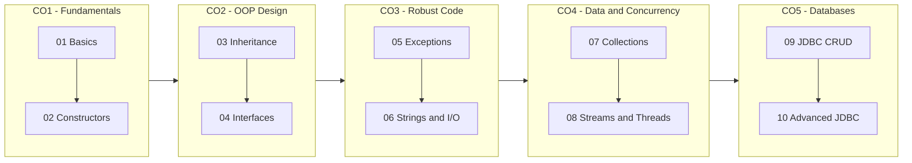

<div align="center">

# Java Lab Practicals

**Ten practicals, from the first `for` loop to connection-pooled JDBC, records and sealed classes.**
**Every program here was compiled, run and verified; every output image is a screenshot of that real run.**


</div>

---

## Submitted by

<table>
  <tr>
    <th align="left" width="140">Name</th>
    <td width="420">Gracy Verma</td>
  </tr>
  <tr>
    <th align="left" width="140">Roll No.</th>
    <td width="420">130410425005</td>
  </tr>
</table>

---

## Practicals

| # | Practical | What it covers | CO | Bloom |
|:-:|:--|:--|:-:|:-:|
| 01 | [**Java Basics**](Java-Lab-Practicals/Lab-01-Java-Basics/README.md) | nested-loop patterns, recursive factorial, primes in a range, string reversal without built-ins | CO1 | K2 |
| 02 | [**BankAccount**](Java-Lab-Practicals/Lab-02-BankAccount-Constructors/README.md) | default, parameterized and copy constructors, overloading, deposit / withdraw with checks | CO1 | K3 |
| 03 | [**Vehicle &rarr; Car &rarr; ElectricCar**](Java-Lab-Practicals/Lab-03-Inheritance-Polymorphism/README.md) | multilevel inheritance, overriding, `super`, dynamic dispatch, `final` method | CO2 | K3 |
| 04 | [**Shape vs Polygon**](Java-Lab-Practicals/Lab-04-Interfaces-Abstract-Classes/README.md) | interfaces, abstract classes, multiple interface implementation, driver class | CO2 | K3 |
| 05 | [**Student Grade System**](Java-Lab-Practicals/Lab-05-Exception-Handling/README.md) | custom `InvalidMarksException`, try-catch-finally, multi-catch, `throw` / `throws`, checked vs unchecked | CO3 | K3 |
| 06 | [**Strings and File I/O**](Java-Lab-Practicals/Lab-06-Strings-File-IO/README.md) | palindrome, word and character frequency, String vs StringBuffer vs StringBuilder, buffered I/O, serialization | CO3 | K3 |
| 07 | [**Inventory Management**](Java-Lab-Practicals/Lab-07-Collections-Inventory/README.md) | `ArrayList` + `Comparator`, `HashMap`, `HashSet`, `PriorityQueue`, `Iterator` | CO4 | K3 |
| 08 | [**Streams, Optional and Threads**](Java-Lab-Practicals/Lab-08-Streams-Optional-Threads/README.md) | lambdas, `groupingBy`, `partitioningBy`, `Optional`, producer-consumer, race condition + `synchronized` | CO4 | K4 |
| 09 | [**JDBC with MySQL**](Java-Lab-Practicals/Lab-09-JDBC-CRUD/README.md) | full CRUD, `Statement`, `PreparedStatement`, batch of 10, commit / rollback transfer, `ResultSet` | CO5 | K4 |
| 10 | [**Advanced JDBC and Modern Java**](Java-Lab-Practicals/Lab-10-Advanced-JDBC-Records-Sealed/README.md) | 4 driver types, HikariCP, `CallableStatement`, savepoints, Collectors, `flatMap`, `reduce`, records, sealed classes | CO5 | K4 |

All practicals: **Relevance** Global &nbsp;·&nbsp; **Hours** 2 each &nbsp;·&nbsp; **Evaluation** Lab Tasks, Viva, Practical Record.

---

## Learning path



---

## What every practical folder contains

Each practical lives in its own folder and holds exactly three files:

| File | Purpose |
|:--|:--|
| `LabXX.java` | the complete program: one self-contained source file with a header comment (aim, CO, run command) |
| `output.png` | screenshot of the program running in a real Windows console |
| `README.md` | aim, CO / Bloom mapping, design diagrams, code walkthrough, output explained, viva questions, result |

```text
gracy/
├── README.md                                   <- you are here
└── Java-Lab-Practicals/
    ├── lib/                                    <- JDBC driver + HikariCP jars (Labs 09 and 10)
    ├── Lab-01-Java-Basics/
    │   ├── Lab01.java
    │   ├── output.png
    │   └── README.md
    ├── Lab-02-BankAccount-Constructors/
    ├── Lab-03-Inheritance-Polymorphism/
    ├── Lab-04-Interfaces-Abstract-Classes/
    ├── Lab-05-Exception-Handling/
    ├── Lab-06-Strings-File-IO/
    ├── Lab-07-Collections-Inventory/
    ├── Lab-08-Streams-Optional-Threads/
    ├── Lab-09-JDBC-CRUD/
    └── Lab-10-Advanced-JDBC-Records-Sealed/
```

---

## Running the programs

**Labs 01 to 08** need only a JDK (17 or newer). Java's single-file launcher compiles and runs in one step:

```bash
cd Java-Lab-Practicals/Lab-01-Java-Basics
java Lab01.java
```

**Labs 09 and 10** also need a running **MySQL 8** server. The required jars are already in [`Java-Lab-Practicals/lib`](Java-Lab-Practicals/lib):

```bash
cd Java-Lab-Practicals/Lab-09-JDBC-CRUD
java -cp "..\lib\*" Lab09.java          # Windows
java -cp "../lib/*" Lab09.java          # Linux / macOS
```

The programs create the `college_lab` database on their own. They log in as `root` / `root` on `localhost:3306` unless the environment variables `DB_URL`, `DB_USER` and `DB_PASS` are set.

---

## Environment used for the recorded runs

| Component | Version |
|:--|:--|
| JDK | Eclipse Temurin OpenJDK **17.0.19** |
| Database | MySQL Community Server **8.0.45** |
| JDBC driver | MySQL Connector/J **8.4.0** (Type 4) |
| Connection pool | HikariCP **5.1.0** with SLF4J 2.0.13 |
| OS | Windows 11 |

<div align="center">
<sub>Source files use plain ASCII output so they run the same in any terminal or IDE.</sub>
</div>
